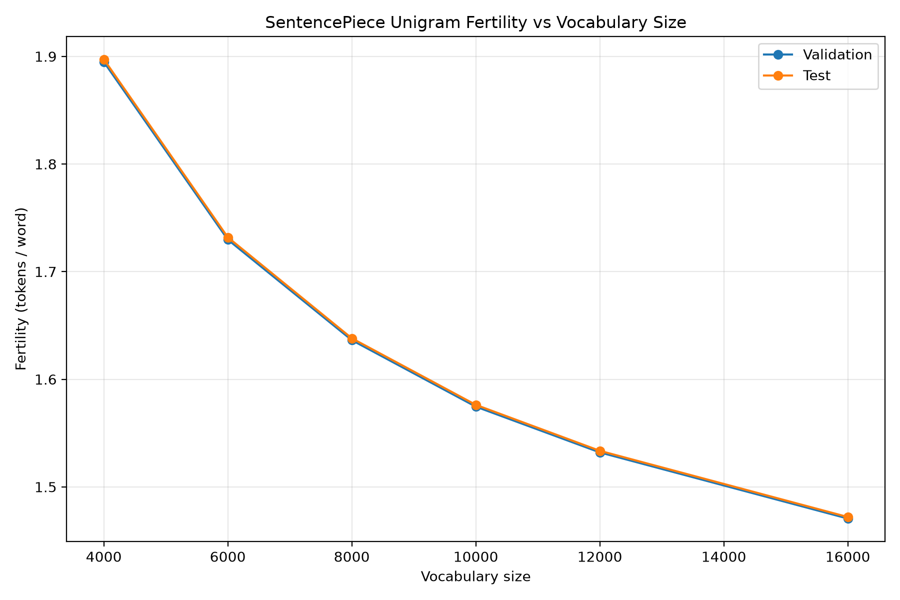
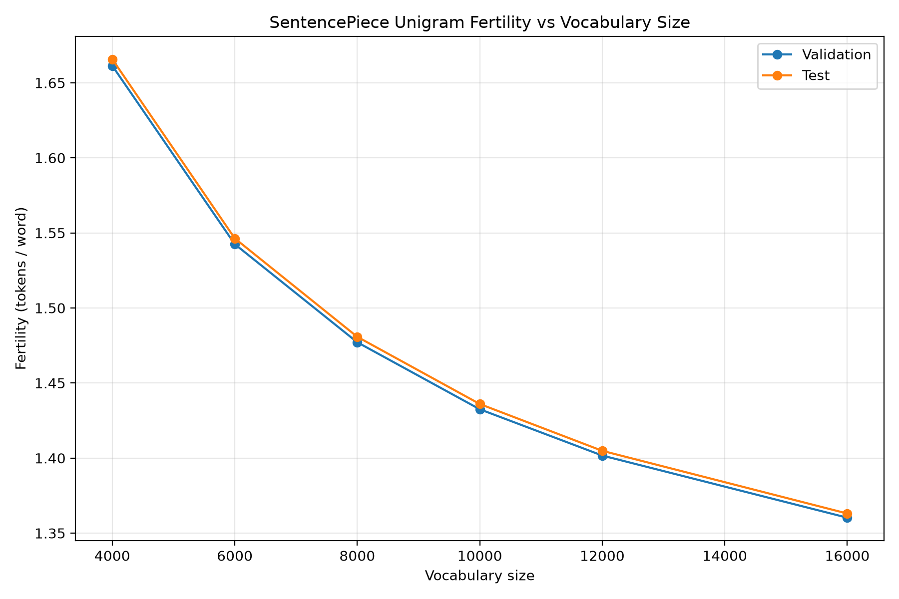

# Phase-1 Report

## Dataset Accumulation
### Prebuilt corpus
1. Sangraha Nepali Corpus - Extracted 500M words
2. Sangraha Hindi Corpus - Extracted 500M words

### Manual collection
#### Consideration
1. NewsPaper Scraping
2. Government sites Scraping
3. Literature scraping (if possible and if necessary)
4. Open subtitles (seems to be a good idea)

#### Actually done
Data extraction from common crawl which includes all kind
of scraping of the web over various domains.

Performed extraction of the URLs using the duckdb database and
got the warc record offsets and later extracted the relevant
text out of these sites using trafilatura efficiently.

## Cleaning and Pre-processing
1. Remove the extremely short docs. (like less than 100 words may be)
1. Remove Garbage docs (like 404 error or loading etc.,)
1. Remove repetitive docs (may be using hashing)
1. Unicode normalization (something like NFC)
1. Language identification using cld2 or 3 but may not necessary as common crawl already runs cld2
1. Score devanagri script ratio in the docs. (threshold like > 80 or > 90)
1. Remove gibberish as well
1. Character level quality filtering (give quality scoring based on these)
   - alphabetic character ratio
   - digits ratio
   - punctuation ratio
   - weird unicode ratio
   - repeated characters ratio
1. Normalize whitespaces (keep paragraph seperation or not ?)
1. Don't overclean punctuation and also normalize quotes
1. Normalize the english digits and devanagri ones (is there a reason to do or not do this ?)
1. Handle things like the Purna Viram (|) and Full Stop (.).
1. Replace URLs with \<URL\> may be for emails as well
1. Deduplication (remember to include the manual one in case of exact deduplication of records or something)
    - Paragraph dedup
    - Near duplicate removal using MinHash (sentence level as well)
    - Exact dedup
1. Perplexity based filtering (optional)
1. Once the document are clean, splitting them into sentences (may or may not be needed)
1. Safety filtering on the content

### Hindi Pre-processing runs
With Dedup
```python
python3 ../cleaning/pipeline.py --input combined_hindi_corpus_copy.jsonl --output cleaned.jsonl
```

``` text
Processing records: 398288rec [1:19:43, 83.25rec/s]
Wrote 280245 cleaned records to cleaned.jsonl
Removal stats:
  - exact_duplicate: 30910
  - garbage_document: 13
  - gibberish: 888
  - low_devanagari_ratio: 23
  - low_quality_characters: 2415
  - near_duplicate: 14155
  - non_hindi: 14988
  - short_document: 54651
Total processed: 398288
Malformed JSON: 0
Empty records: 0
Word Count = 289074480

Perplexity Filtering
Percentiles:
P1     = 97.8483
P5     = 183.8402
P10    = 262.6902
P25    = 478.6698
P50    = 1029.2511
P75    = 2818.4101
P90    = 10538.5794
P95    = 34610.1930
P99    = 308546.6750
P99.5  = 404011.6576
P99.9  = 733961.145

============================================================
FILTER CONFIGURATION
============================================================
Bottom percentile filtering: disabled
Top 25.0%: PPL >= 2818.4101
Maximum PPL threshold: disabled
Minimum PPL threshold: 5.0000

============================================================
FILTER RESULTS
============================================================
Input scored      : 280,245
Removed bottom    : 0
Removed top       : 70,062
Removed threshold : 10
Total removed     : 70,072
Kept              : 210,173
Output             : cleaned_ppl.jsonl
Statistics: perplexity_stats.json
Word Count = 247580497

Documents:              280,245
Alphabetic characters:   759,047,664
Devanagari characters:   732,600,227
Devanagari percentage:   96.52%

============================================================
Hindi BLOCKLIST FILTER
============================================================
Input records       : 210,173
Invalid/skipped     : 0
Blocked/removed     : 356
Kept                : 209,817
Removed percentage  : 0.17%
Blocklist words     : 134
Maximum blocked ratio: 2.00%
Output              : manual_cleaned.jsonl
Word Count = 247138932

Manual documents kept : 81,550
Manual words kept     : 99,998,974

Target total words : 500,000,000
Manual words        : 99,998,974
Sangraha needed     : 400,001,026
Deduplicating Sangraha: 932276rec [21:25, 1043.10rec/s]
Reached target word count.
Deduplicating Sangraha: 932387rec [21:26, 725.01rec/s]

======================================================================
FINAL DATASET
======================================================================
Manual records        : 81,550
Manual words          : 99,998,974
Sangraha processed    : 932,388
Sangraha kept         : 932,270
Sangraha duplicates   : 64
Sangraha words kept   : 400,007,142
FINAL WORDS           : 500,006,116
TARGET WORDS          : 500,000,000
Output                : final_dataset.jsonl

Train Test Val Split
Reading final_dataset.jsonl...
Processed 1,000,000 records | 493,039,617 words

======================================================================
CORPUS
======================================================================
Total words:     498,874,342
Manual words:    99,438,514
Sangraha words:  399,435,828
Manual ratio:    19.933%
Sangraha ratio:  80.067%

Shuffling manual corpus...
Shuffling Sangraha corpus...

======================================================================
TARGET SPLIT
======================================================================
Train:       357,142,857 words (~500,000,000 tokens)
Validation:  70,865,742 words
Test:        70,865,742 words

Writing datasets...

======================================================================
FINAL DATASET
======================================================================

TRAIN
  Total words:     357,154,414
  Estimated tokens:500,016,180
  Manual:          71,193,055
  Sangraha:        285,961,359
  Manual ratio:    19.933%

VALIDATION
  Total words:     70,867,645
  Estimated tokens:99,214,703
  Manual:          14,126,837
  Sangraha:        56,740,808
  Manual ratio:    19.934%

TEST
  Total words:     70,852,283
  Estimated tokens:99,193,196
  Manual:          14,118,622
  Sangraha:        56,733,661
  Manual ratio:    19.927%

======================================================================
FILES
======================================================================
splits/train.jsonl
splits/validation.jsonl
splits/test.jsonl
```

### Nepali runs
With Deduplication
```python
python3 ../cleaning/pipeline.py --input combined_nepali_corpus_copy.jsonl --output cleaned2.jsonl
```
```text
Processing records: 316092rec [34:36, 152.25rec/s]
Wrote 236748 cleaned records to cleaned2.jsonl
Removal stats:
  - exact_duplicate: 12229
  - gibberish: 187
  - low_quality_characters: 88
  - near_duplicate: 15569
  - non_nepali: 8552
  - short_document: 42719
Total processed: 316092
Malformed JSON: 0
Empty records: 0
Word Count = 106803363

In the cleaned2.jsonl
Documents:              236,748
Alphabetic characters:   368,021,652
Devanagari characters:   365,471,134
Devanagari percentage:   99.31%

Perplexity Filtering
In the cleaned_ppl.jsonl
Percentiles:
P1     = 37.8077
P5     = 236.1216
P10    = 382.8141
P25    = 705.2136
P50    = 1356.1301
P75    = 2903.0493
P90    = 7281.0680
P95    = 13811.1519
P99    = 63039.7616
P99.5  = 107390.6922
P99.9  = 434021.6703

============================================================
FILTER CONFIGURATION
============================================================
Bottom percentile filtering: disabled
Top 10.0%: PPL >= 7281.0680
Maximum PPL threshold: disabled
Minimum PPL threshold: 5.0000

============================================================
FILTER RESULTS
============================================================
Input scored      : 236,748
Removed bottom    : 0
Removed top       : 23,675
Removed threshold : 5
Total removed     : 23,680
Kept              : 213,068
Output             : cleaned_ppl.jsonl
Statistics: perplexity_stats.json
Word Count = 92365343

After Safety filtering
============================================================
NEPALI BLOCKLIST FILTER
============================================================
Input records       : 213,068
Invalid/skipped     : 0
Blocked/removed     : 1,239
Kept                : 211,829
Removed percentage  : 0.58%
Blocklist words     : 98
Maximum blocked ratio: 2.00%
Output              : manual_cleaned.jsonl
Word Count = 92448649

Final Merging
Manual words kept     : 93,325,568

Target total words : 500,000,000
Manual words        : 93,325,568
Sangraha needed     : 406,674,432
Deduplicating Sangraha: 1353187rec [23:30, 795.94rec/s]
Reached target word count.
Deduplicating Sangraha: 1353273rec [23:30, 959.11rec/s]

======================================================================
FINAL DATASET
======================================================================
Manual records        : 211,829
Manual words          : 93,325,568
Sangraha processed    : 1,353,274
Sangraha kept         : 1,352,548
Sangraha duplicates   : 726
Sangraha words kept   : 406,674,795
FINAL WORDS           : 500,000,363
TARGET WORDS          : 500,000,000
Output                : final_dataset.jsonl

Train Test Val Split
======================================================================
CORPUS
======================================================================
Total words:     498,153,961
Manual words:    92,916,008
Sangraha words:  405,237,953
Manual ratio:    18.652%
Sangraha ratio:  81.348%

Shuffling manual corpus...
Shuffling Sangraha corpus...

======================================================================
TARGET SPLIT
======================================================================
Train:       357,142,857 words (~500,000,000 tokens)
Validation:  70,505,552 words
Test:        70,505,552 words

Writing datasets...

======================================================================
FINAL DATASET
======================================================================

TRAIN
  Total words:     357,143,405
  Estimated tokens:500,000,767
  Manual:          66,614,806
  Sangraha:        290,528,599
  Manual ratio:    18.652%

VALIDATION
  Total words:     70,507,150
  Estimated tokens:98,710,010
  Manual:          13,151,850
  Sangraha:        57,355,300
  Manual ratio:    18.653%

TEST
  Total words:     70,503,406
  Estimated tokens:98,704,768
  Manual:          13,149,352
  Sangraha:        57,354,054
  Manual ratio:    18.651%

======================================================================
FILES
======================================================================
splits/train.jsonl
splits/validation.jsonl
splits/test.jsonl
```

## Tokenization report
Chose unigram tokenizer for both as it seemed better to do a top down approach with all the matras and halants and all.
### Nepali
#### Evaluation Summary
| Dataset |        Vocab   |      Words   |     Tokens   |    UNK |  Fertility |  Chars/Tok  |   UNK Rate |  UNK Records
|-------------|----------|--------------|-----------------|---------|-----------|-----------|--------------|------------|
| test        |    4,000 |   70,503,406 |  133,766,591    |     0   | 1.897307  |    2.8894 |  0.000000%   |          0 |
| test        |    6,000 |   70,503,406 |  122,105,099    |     0   | 1.731904  |    3.1654 |  0.000000%   |          0 |
| test        |    8,000 |   70,503,406 |  115,490,552    |     0   | 1.638085  |    3.3467 |  0.000000%   |          0 |
| test        |   10,000 |   70,503,406 |  111,130,811    |     0   | 1.576247  |    3.4780 |  0.000000%   |          0 |
| test        |   12,000 |   70,503,406 |  108,119,964    |     0   | 1.533542  |    3.5748 |  0.000000%   |          0 |
| test        |   16,000 |   70,503,406 |  103,782,720    |     0   | 1.472024  |    3.7242 |  0.000000%   |          0 |
| validation  |    4,000 |   70,507,150 |  133,606,342    |     0   | 1.894933  |    2.8919 |  0.000000%   |          0 |
| validation  |    6,000 |   70,507,150 |  121,961,162    |     0   | 1.729770  |    3.1681 |  0.000000%   |          0 |
| validation  |    8,000 |   70,507,150 |  115,375,770    |     0   | 1.636370  |    3.3489 |  0.000000%   |          0 |
| validation  |   10,000 |   70,507,150 |  111,019,573    |     0   | 1.574586  |    3.4803 |  0.000000%   |          0 |
| validation  |   12,000 |   70,507,150 |  108,021,863    |     0   | 1.532070  |    3.5769 |  0.000000%   |          0 |
| validation  |   16,000 |   70,507,150 |  103,688,016    |     0   | 1.470603  |    3.7264 |  0.000000%   |          0 |



#### For the chosen 10K vocab model (keeping the model parameter constraint in mind)

Frequent Tokens Stats

| token | count | frequency (%) |
|-------|-------|---------------|
| ▁|7772811|0.06994289819409309|
| ।|4414477|0.039723250107479194|
| को|2495660|0.022456958403731977|
| ","|2119504|0.01907215452607468|
| मा|1991742|0.017922500358608918|
| ▁र|1401568|0.012611875927010017|
| ▁छ|1336893|0.012029904110031195|
| का|1214738|0.010930703997112016|
| ले|1211461|0.010901216225264477|
| लाई|712527|0.006411606228627271|
| ▁पनि|619457|0.005574124713262464|
| '|575270|0.005176512209561757|
| -|468585|0.0042165174156787175|
| ▁छन्|454483|0.0040896219141242475|
| न|452279|0.0040697894304037785|

Examples

================================================================================
Example 1
Text:
काठमाडौं । उत्तर कोरिया र अमेरिकाबीच जुन १२ तारिखमा हुने भनिएको शिखर वार्तामा ढिलाइ हुने भएको छ । अमेरिकी राष्ट्रपति डोनाल्ड ट्रम्पले उत्तर कोरियाली नेता किम जोङ-उनसँगको ऐतिहासिक शिखर वार्तामा केही ढिलाई हुनसक्ने बताए ।
 वार्ताका विषयमा छलफल गर्न ह्वाइट हाउसमा पुगेका दक्षिण कोरियाका राष्ट्रपति मून जेइनसँग कुरा गर्दै राष्ट्रपति ट्रम्पले वार्तामा केही ढिलाई हुनसक्ने बताएका हुन् ।
 उत्तर कोरियाले निश्चित सर्तहरु पूरा नगरे उक्त शिखर बैठक पर सर्ने ट्रम्पको भनाइ थियो । उनले अहिलेको स्थितिमा उत्तर कोरियासँग वार्ता हुन नसके त्यसपछि कहिल्यै हुन नसक्ने पनि बताएका छन् ।
 वार्ताका लागि अमेरिकाले उत्तर कोरियासँग परमाणु हतियार नष्ट गर्न लगातार दबाब दिँदै आएको छ । अघिल्लो हप्ता उत्तर कोरियाले अमेरिकाले परमाणु हतियारको विषयलाई लिएर एकतर्फी दबाब दिइरहे वार्ता रद्द पनि हुनसक्ने बताएको थियो ।

Words: 123
Pieces:
▁काठमाडौं | ▁ | । | ▁उत्तर | ▁कोरिया | ▁र | ▁अमेरिका | बीच | ▁जुन | ▁१२ | ▁तारिख | मा | ▁हुने | ▁भनिएको | ▁शिखर | ▁वार्ता | मा | ▁ढिलाइ | ▁हुने | ▁भएको | ▁छ | ▁ | । | ▁अमेरिकी | ▁राष्ट्रपति | ▁डोनाल्ड | ▁ट्रम्पले | ▁उत्तर | ▁कोरियाली | ▁नेता | ▁कि | म | ▁जो | ङ | - | उन | सँगको | ▁ऐतिहासिक | ▁शिखर | ▁वार्ता | मा | ▁केही | ▁ | ढि | लाई | ▁हुनसक्ने | ▁बताए | ▁ | । | ▁वार्ता | का | ▁विषयमा | ▁छलफल | ▁गर्न | ▁ह्वाइट | ▁हाउस | मा | ▁पुगेका | ▁दक्षिण | ▁कोरिया | का | ▁राष्ट्रपति | ▁ | मू | न | ▁जे | इन | सँग | ▁कुरा | ▁गर्दै | ▁राष्ट्रपति | ▁ट्रम्पले | ▁वार्ता | मा | ▁केही | ▁ | ढि | लाई | ▁हुनसक्ने | ▁बताएका | ▁हुन् | ▁ | । | ▁उत्तर | ▁कोरिया | ले | ▁निश्चित | ▁सर्त | हरु | ▁पूरा | ▁नगरे | ▁उक्त | ▁शिखर | ▁बैठक | ▁पर | ▁सर | ्ने | ▁ट्रम्प | को | ▁भनाइ | ▁थियो | ▁ | । | ▁उनले | ▁अहिलेको | ▁स्थितिमा | ▁उत्तर | ▁कोरिया | सँग | ▁वार्ता | ▁हुन | ▁नसके | ▁त्यसपछि | ▁कहिल्यै | ▁हुन | ▁नसक्ने | ▁पनि | ▁बताएका | ▁छन् | ▁ | । | ▁वार्ता | का | ▁लागि | ▁अमेरिकाले | ▁उत्तर | ▁कोरिया | सँग | ▁परमाणु | ▁हतियार | ▁नष्ट | ▁गर्न | ▁लगातार | ▁दबाब | ▁दिँदै | ▁आएको | ▁छ | ▁ | । | ▁अघिल्लो | ▁हप्ता | ▁उत्तर | ▁कोरिया | ले | ▁अमेरिकाले | ▁परमाणु | ▁हतियार | को | ▁विषयलाई | ▁लिएर | ▁एकतर्फी | ▁दबाब | ▁दि | इरहे | ▁वार्ता | ▁रद्द | ▁पनि | ▁हुनसक्ने | ▁बताएको | ▁थियो | ▁ | ।

Token IDs:
355 273 6 1400 2500 276 1175 523 585 690 6472 275 305 1612 5116 2067 275 4922 305 283 277 273 6 979 719 7195 5426 1400 8114 489 372 300 619 707 12 1834 2045 2380 5116 2067 275 344 273 3952 280 3781 327 273 6 2067 279 605 621 284 9710 4331 275 1372 1211 2500 279 719 273 3391 286 1108 1535 323 367 326 719 5426 2067 275 344 273 3952 280 3781 611 362 273 6 1400 2500 278 1641 5074 319 763 3347 448 5116 684 1226 1689 452 4504 274 731 293 273 6 309 2216 5761 1400 2500 323 2067 330 5378 748 2099 330 1651 281 611 282 273 6 2067 279 285 4468 1400 2500 323 9173 3254 3924 284 2427 2034 1694 402 277 273 6 1657 1949 1400 2500 278 4468 9173 3254 274 3487 804 9611 2034 2188 5887 2067 5640 281 3781 2314 293 273 6

================================================================================
Example 2
Text:
दार्चुला । दार्चुलामा नेपाल-भारत जोड्ने गरी महाकाली नदीमाथि दुईवटा झोलुङ्गे पुल निर्माण सम्पन्न भएका छन् । तुइन विस्थापनअन्तर्गत ती नदीमाथि पुल निर्माण गरिएको हो । व्याँस गाउँपालिका-६ बडुगाउँ र मालिकार्जुन गाउँपालिका-६ बाँकुमा झोलुङ्गे पुल निर्माण भएको हो । पुन बनेसँगै अहिले स्थानीयवासी खुसी भएका छन् ।
 महाकाली नदीमा जोखिम मोलेर नदी आउजाउ गर्नुपर्ने अवस्था अन्त्य भएको जनाइएको छ । मालिकार्जुन -६ का तेजबहादुर चन्दले भन्नुभयो, "बल्ल अहिले आएर पुल निर्माण भयो । " स्थानीय पूर्वाधार विकास तथा कृषि सडक विभागअन्तर्गत सस्पेन्सन ब्रिज डिभिजनले अहिले जिल्लाको महाकाली नदीमाथि चार झोलुङ्गे पुल निर्माण गरिरहेको छ ।
 दार्चुलाका प्रमुख जिल्ला अधिकारी दीर्घराज उपाध्याय, भारत पिथौरागढ जिल्ला अधिकारी आशिष चौहानले बिहीबार मालिकार्जुन-६ बाँकु स्थित पुलको शुभारम्भ गर्नुभयो भने व्याँस -६ बडुगाउँस्थित झोलुङ्गे पुलको व्याँस गाउँपालिका अध्यक्ष मङ्गलसिंह धामीले शुभारम्भ गर्नुभएको हो ।
 पुल निर्माणपछि दुवै ठाउँका स्थानीयवासी खुसी देखिएका हुन् । व्याँस -६ का कलावती भट्ट तुइन विस्थापनअन्तर्गत झोलुङ्गे पुल निर्माण भएपछि आवतजावतमा सहज हुने बताउनुहुन्छ । वर्षौँदेखि तुइनको सहारामा महाकाली नदी वारपार गर्दै आउनुएका उहाँ बिहीबारदेखि तुइनको ठाउँमा झोलुङगे पुल सञ्चालन भएपछि खुसी देखिनुभयो ।
 उहाँले भन्नुभयो, "कयौँ बर्खा यो महाकाली नदीमा अकालमै ज्यान गुमाउन बाध्य थिए । अब तुइनका कारण ज्यान गुमाउनुपर्ने अवस्था आउने छैन । " व्याँस -६ बडुगाउँ क्षेत्रका स्थानीयवासी नेपाल-भारत वारपार गर्न पुल नहुँदा तुइनको सहारामा आउजाउ गर्थे । नेपालतिरको बाटो जाने हो भने छ घण्टा समय लाग्छ ।
 भारतबाट जाँदा यसअघि तिगरम भएर जाँदा अढाइ घण्टा बढी समय लाग्ने गरेको थियो । अहिले बडुगाउँमा झोलुङ्गे पुल निर्माण भएपछि आधा घण्टामा सदरमुकाम खलङ्गा आउजाउ गर्न सहज भएको छ । मालिकार्जुन-६ का काशी विकले १० वर्षदेखि यस क्षेत्रमा झोलुङ्गे पुल निर्माण हुन्छ भन्ने सुने पनि अहिले आएर पुल निर्माण सकिएको बताउनुहुन्छ । "अहिले आएर पुल निर्माण पूरा भएर सञ्चालन हुँदा खुसी छौँ । बाकु र भारतको द्वालीसेरा जोड्ने गरी झोलुङ्गे पुल सञ्चालन भएपछि हामीलाई हिउँद-बर्खामा यात्रा सहज हुनेछ", उहाँले भन्नुभयो ।
 नागरिकले झोलुङ्गे पुल नहुँदा ट्युबमार्फत यो क्षेत्रमा आवतजावत गर्न बाध्य थिए । दैनिक उपभोग्य सामान त्यहीँ ट्युबको माध्यमबाट वारपार हुन्थ्यो । झोलुङ्गे पुल निर्माणपछि अब मालिकार्जुन र लेकम क्षेत्रका नागरिकलाई समेत वारपार गर्न सहज भएको उहाँले बताउनुभयो ।

Words: 339
Pieces:
▁दार्चुला | ▁ | । | ▁दार्चुला | मा | ▁नेपाल | - | भारत | ▁जोड्ने | ▁गरी | ▁महाकाली | ▁नदी | माथि | ▁दुईवटा | ▁ | झो | लु | ङ्गे | ▁पुल | ▁निर्माण | ▁सम्पन्न | ▁भएका | ▁छन् | ▁ | । | ▁ | तु | इन | ▁वि | स्थापन | अन्तर्गत | ▁ती | ▁नदी | माथि | ▁पुल | ▁निर्माण | ▁गरिएको | ▁हो | ▁ | । | ▁ | व्या | ँ | स | ▁गाउँपालिका | - | ६ | ▁ब | डु | गाउँ | ▁र | ▁ | मा | लिका | र्ज | ु | न | ▁गाउँपालिका | - | ६ | ▁ | बाँ | कु | मा | ▁ | झो | लु | ङ्गे | ▁पुल | ▁निर्माण | ▁भएको | ▁हो | ▁ | । | ▁पुन | ▁बने | सँगै | ▁अहिले | ▁स्थानीयवासी | ▁खुसी | ▁भएका | ▁छन् | ▁ | । | ▁महाकाली | ▁नदीमा | ▁जोखिम | ▁मो | ले | र | ▁नदी | ▁आउजाउ | ▁गर्नुपर्ने | ▁अवस्था | ▁अन्त्य | ▁भएको | ▁जनाइएको | ▁छ | ▁ | । | ▁ | मा | लिका | र्ज | ु | न | ▁ | - | ६ | ▁ | का | ▁तेज | बहादुर | ▁चन्द | ले | ▁भन्नुभयो | , | ▁ | " | ब | ल्ल | ▁अहिले | ▁आएर | ▁पुल | ▁निर्माण | ▁भयो | ▁ | । | ▁ | " | ▁स्थानीय | ▁पूर्वाधार | ▁विकास | ▁तथा | ▁कृषि | ▁सडक | ▁विभाग | अन्तर्गत | ▁स | स्प | ेन्स | न | ▁ | ब्रि | ज | ▁डिभिजन | ले | ▁अहिले | ▁जिल्लाको | ▁महाकाली | ▁नदी | माथि | ▁चार | ▁ | झो | लु | ङ्गे | ▁पुल | ▁निर्माण | ▁गरिरहेको | ▁छ | ▁ | । | ▁दार्चुला | का | ▁प्रमुख | ▁जिल्ला | ▁अधिकारी | ▁दीर्घ | राज | ▁उपाध्याय | , | ▁भारत | ▁पि | थ | ौ | रा | गढ | ▁जिल्ला | ▁अधिकारी | ▁आशिष | ▁चौ | हान | ले | ▁बिहीबार | ▁ | मा | लिका | र्ज | ु | न | - | ६ | ▁ | बाँ | कु | ▁ | स्थित | ▁पुल | को | ▁शुभारम्भ | ▁गर्नुभयो | ▁भने | ▁ | व्या | ँ | स | ▁ | - | ६ | ▁ब | डु | गाउँ | स्थित | ▁ | झो | लु | ङ्गे | ▁पुल | को | ▁ | व्या | ँ | स | ▁गाउँपालिका | ▁अध्यक्ष | ▁म | ङ्ग | ल | सिंह | ▁धामी | ले | ▁शुभारम्भ | ▁गर्नुभएको | ▁हो | ▁ | । | ▁पुल | ▁निर्माण | पछि | ▁दुवै | ▁ठाउँ | का | ▁स्थानीयवासी | ▁खुसी | ▁देखिएका | ▁हुन् | ▁ | । | ▁ | व्या | ँ | स | ▁ | - | ६ | ▁ | का | ▁कला | वती | ▁भट्ट | ▁ | तु | इन | ▁वि | स्थापन | अन्तर्गत | ▁ | झो | लु | ङ्गे | ▁पुल | ▁निर्माण | ▁भएपछि | ▁आवतजावत | मा | ▁सहज | ▁हुने | ▁बताउनुहुन्छ | ▁ | । | ▁वर्ष | ौँ | देखि | ▁ | तु | इन | को | ▁सहारा | मा | ▁महाकाली | ▁नदी | ▁ | वार | पार | ▁गर्दै | ▁आउनु | एका | ▁उहाँ | ▁बिहीबार | देखि | ▁ | तु | इन | को | ▁ठाउँमा | ▁ | झो | लुङ | गे | ▁पुल | ▁सञ्चालन | ▁भएपछि | ▁खुसी | ▁देखिन | ुभयो | ▁ | । | ▁उहाँले | ▁भन्नुभयो | , | ▁ | " | क | यौँ | ▁बर् | खा | ▁यो | ▁महाकाली | ▁नदीमा | ▁अ | काल | मै | ▁ज्यान | ▁गुमाउन | ▁बाध्य | ▁थिए | ▁ | । | ▁अब | ▁ | तु | इन | का | ▁कारण | ▁ज्यान | ▁गुमाउन | ुपर्ने | ▁अवस्था | ▁आउने | ▁छैन | ▁ | । | ▁ | " | ▁ | व्या | ँ | स | ▁ | - | ६ | ▁ब | डु | गाउँ | ▁क्षेत्रका | ▁स्थानीयवासी | ▁नेपाल | - | भारत | ▁ | वार | पार | ▁गर्न | ▁पुल | ▁नहुँदा | ▁ | तु | इन | को | ▁सहारा | मा | ▁आउजाउ | ▁गर्थे | ▁ | । | ▁नेपाल | तिर | को | ▁बाटो | ▁जाने | ▁हो | ▁भने | ▁छ | ▁घण्टा | ▁समय | ▁लाग्छ | ▁ | । | ▁भारतबाट | ▁जाँदा | ▁यसअघि | ▁ | ति | गर | म | ▁भएर | ▁जाँदा | ▁अ | ढ | ाइ | ▁घण्टा | ▁बढी | ▁समय | ▁लाग्ने | ▁गरेको | ▁थियो | ▁ | । | ▁अहिले | ▁ब | डु | गाउँ | मा | ▁ | झो | लु | ङ्गे | ▁पुल | ▁निर्माण | ▁भएपछि | ▁आधा | ▁घण्टामा | ▁सदरमुकाम | ▁ | खल | ङ्गा | ▁आउजाउ | ▁गर्न | ▁सहज | ▁भएको | ▁छ | ▁ | । | ▁ | मा | लिका | र्ज | ु | न | - | ६ | ▁ | का | ▁ | का | शी | ▁विक | ले | ▁१० | ▁वर्षदेखि | ▁यस | ▁क्षेत्रमा | ▁ | झो | लु | ङ्गे | ▁पुल | ▁निर्माण | ▁हुन्छ | ▁भन्ने | ▁सुने | ▁पनि | ▁अहिले | ▁आएर | ▁पुल | ▁निर्माण | ▁सकिएको | ▁बताउनुहुन्छ | ▁ | । | ▁ | " | अहिले | ▁आएर | ▁पुल | ▁निर्माण | ▁पूरा | ▁भएर | ▁सञ्चालन | ▁हुँदा | ▁खुसी | ▁छौँ | ▁ | । | ▁बा | कु | ▁र | ▁भारतको | ▁ | द्व | ा | ली | से | रा | ▁जोड्ने | ▁गरी | ▁ | झो | लु | ङ्गे | ▁पुल | ▁सञ्चालन | ▁भएपछि | ▁हामीलाई | ▁हिउँद | - | बर् | खा | मा | ▁यात्रा | ▁सहज | ▁हुनेछ | " | , | ▁उहाँले | ▁भन्नुभयो | ▁ | । | ▁नागरिकले | ▁ | झो | लु | ङ्गे | ▁पुल | ▁नहुँदा | ▁ | ट | ्यु | ब | मार्फत | ▁यो | ▁क्षेत्रमा | ▁आवतजावत | ▁गर्न | ▁बाध्य | ▁थिए | ▁ | । | ▁दैनिक | ▁उपभोग्य | ▁सामान | ▁त्यहीँ | ▁ | ट | ्यु | ब | को | ▁माध्यमबाट | ▁ | वार | पार | ▁हुन्थ्यो | ▁ | । | ▁ | झो | लु | ङ्गे | ▁पुल | ▁निर्माण | पछि | ▁अब | ▁ | मा | लिका | र्ज | ु | न | ▁र | ▁ | ले | क | म | ▁क्षेत्रका | ▁नागरिकलाई | ▁समेत | ▁ | वार | पार | ▁गर्न | ▁सहज | ▁भएको | ▁उहाँले | ▁बताउनुभयो | ▁ | ।

Token IDs:
6407 273 6 6407 275 313 12 3819 3573 324 5861 1823 508 4229 273 6431 1098 7494 1320 395 626 335 282 273 6 273 1473 1535 514 5002 1222 669 1823 508 1320 395 318 288 273 6 273 2495 361 302 727 12 701 495 2515 2601 276 273 275 3962 2588 339 286 727 12 701 273 5651 1216 275 273 6431 1098 7494 1320 395 283 288 273 6 1975 3577 536 391 4500 1835 335 282 273 6 5861 4309 1243 1579 278 296 1823 9953 642 473 1441 283 2475 277 273 6 273 275 3962 2588 339 286 273 12 701 273 279 4557 516 2794 278 1831 9 273 15 383 3543 391 2217 1320 395 421 273 6 273 15 393 1254 394 295 673 526 1432 1222 594 2533 3364 286 273 4135 334 3094 278 391 2110 5861 1823 508 609 273 6431 1098 7494 1320 395 867 277 273 6 6407 279 375 387 741 5885 502 4984 9 776 1044 589 640 352 5794 387 741 6925 2491 2481 278 1214 273 275 3962 2588 339 286 12 701 273 5651 1216 273 524 1320 274 7766 1489 290 273 2495 361 302 273 12 701 495 2515 2601 524 273 6431 1098 7494 1320 274 273 2495 361 302 727 348 373 1037 301 2080 6782 278 7766 1296 288 273 6 1320 395 366 746 1261 279 4500 1835 2205 362 273 6 273 2495 361 302 273 12 701 273 279 2189 5581 3159 273 1473 1535 514 5002 1222 273 6431 1098 7494 1320 395 665 7004 275 991 305 7329 273 6 358 788 377 273 1473 1535 274 7160 275 5861 1823 273 1798 3747 326 3373 1923 1595 1214 377 273 1473 1535 274 1062 273 6431 5418 1602 1320 521 665 1835 3174 1536 273 6 671 1831 9 273 15 298 5079 1840 681 294 5861 4309 337 2862 412 1257 6553 1942 310 273 6 465 273 1473 1535 279 347 1257 6553 1089 473 677 341 273 6 273 15 273 2495 361 302 273 12 701 495 2515 2601 1506 4500 313 12 3819 273 1798 3747 284 1320 2079 273 1473 1535 274 7160 275 9953 4187 273 6 313 774 274 1063 700 288 290 277 1409 386 1344 273 6 3644 1990 864 273 520 1446 300 652 1990 337 1308 892 1409 398 386 1208 289 293 273 6 391 495 2515 2601 275 273 6431 1098 7494 1320 395 665 2292 3704 2784 273 4777 4965 9953 284 991 283 277 273 6 273 275 3962 2588 339 286 12 701 273 279 273 279 2038 3481 278 486 2347 346 464 273 6431 1098 7494 1320 395 342 332 5025 281 391 2217 1320 395 3007 7329 273 6 273 15 3292 2217 1320 395 763 652 521 615 1835 1877 273 6 725 1216 276 1558 273 4207 315 492 905 352 3573 324 273 6431 1098 7494 1320 521 665 1559 6147 12 5174 681 275 1111 991 528 15 9 671 1831 273 6 5270 273 6431 1098 7494 1320 2079 273 336 1690 383 691 294 464 7004 284 1942 310 273 6 926 7939 1546 6484 273 336 1690 383 274 2477 273 1798 3747 2378 273 6 273 6431 1098 7494 1320 395 366 465 273 275 3962 2588 339 286 276 273 278 298 300 1506 3300 384 273 1798 3747 284 991 283 671 901 273 6

### Hindi
#### Evaluation Summary
|Dataset     |    Vocab |        Words  |      Tokens    |   UNK |  Fertility  | Chars/Tok  |   UNK Rate  | UNK Records|
|------------|----------|---------------|----------------|-------|-------------|------------|-------------|------------|
|test        |    4,000 |   70,852,283  | 118,021,659    |     0 |   1.665742  |    2.4996  | 0.000000%   |          0 |
|test        |    6,000 |   70,852,283  | 109,564,214    |     0 |   1.546375  |    2.6926  | 0.000000%   |          0 |
|test        |    8,000 |   70,852,283  | 104,917,160    |     0 |   1.480787  |    2.8118  | 0.000000%   |          0 |
|test        |   10,000 |   70,852,283  | 101,746,041    |     0 |   1.436031  |    2.8995  | 0.000000%   |          0 |
|test        |   12,000 |   70,852,283  |  99,535,951    |     0 |   1.404838  |    2.9638  | 0.000000%   |          0 |
|test        |   16,000 |   70,852,283  |  96,576,460    |     0 |   1.363068  |    3.0547  | 0.000000%   |          0 |
|validation  |    4,000 |   70,867,645  | 117,738,665    |     0 |   1.661388  |    2.5030  | 0.000000%   |          0 |
|validation  |    6,000 |   70,867,645  | 109,314,423    |     0 |   1.542515  |    2.6959  | 0.000000%   |          0 |
|validation  |    8,000 |   70,867,645  | 104,682,347    |     0 |   1.477153  |    2.8152  | 0.000000%   |          0 |
|validation  |   10,000 |   70,867,645  | 101,519,763    |     0 |   1.432526  |    2.9029  | 0.000000%   |          0 |
|validation  |   12,000 |   70,867,645  |  99,334,274    |     0 |   1.401687  |    2.9668  | 0.000000%   |          0 |
|validation  |   16,000 |   70,867,645  |  96,401,411    |     0 |   1.360302  |    3.0570  | 0.000000%   |          0 |




#### For the chosen 8K vocab model (keeping the model parameter constraint in mind)

Frequent Tokens Stats

| token | count | frequency (%) |
|-------|-------|---------------|
| ▁| 4942551| 0.04710908110741846
| ।| 3115379| 0.029693703108242733
| ▁के| 2758468| 0.02629186684046728
| ▁है| 2154701| 0.020537164749789262
| ","| 2139600| 0.020393232146199917
| ▁में| 1993508| 0.019000781187748506
| ▁की| 1581573| 0.01507449305718912
| ▁और| 1314217| 0.012526234983867271
| ▁से| 1246719| 0.011882889319535527
| ▁को| 1233731| 0.0117590964147333
| ▁का| 1043102| 0.00994214864374903
| ▁हैं| 845377| 0.008057566560131822
| -| 812732| 0.007746416315500724
| .| 770511| 0.0073439940616006
| ▁पर| 737252| 0.007026991580786212

Examples

Example 1

Text:

Bokaro : गणपति महोत्सव को लेकर बोकारो में लगभग सभी तैयारियां पूरी कर ली गई है. बोकारो के आधा दर्जन जगहों पर आकर्षक पंडाल बनाए गए हैं. सेक्टर-4 के मजदूर मैदान में 16 फीट लंबा गणपति की मूर्ति स्थापित की गई है. यह आयोजन 31 से 9 सितंबर तक चलेगा. इस पंडाल को पश्चिम बंगाल के मुर्शिदाबाद के कारीगरों ने बनाया है. इस अवसर पर मेला का भी आयोजन किया गया है, जहां बच्चों के मनोरंजन के लिए भरपूर व्यवस्था की गई है. दूसरी ओर सेक्टर-4 में आकर्षक पंडाल बनाए गए हैं, जबकि अनोखी लाइटिंग की व्यवस्था की गई है. दूसरी तरफ सेक्टर-2 बी पोस्ट ऑफिस के पास भी भव्य मेला लगाया जा रहा है. मेले में कई दुकानें लगाने के लिए अनुमति प्रदान कर दी गई है. इस बाबत सुरक्षा व्यवस्था का भी इंतजाम किया गया है. सिटी डीएसपी कुलदीप चौधरी ने बताया कि शहर में गश्त तेज करने, मनचले युवकों पर पैनी नजर बनाए रखने का निर्देश दिया गया है. पूजा को शांतिपूर्ण संपन्न कराने के लिए उन्होंने सहयोग करने की अपील की है.

Words: 176

Pieces:

▁B | ok | ar | o | ▁ | : | ▁ | गण | पति | ▁महोत्सव | ▁को | ▁लेकर | ▁बो | कार | ो | ▁में | ▁लगभग | ▁सभी | ▁तैयार | ियां | ▁पूरी | ▁कर | ▁ली | ▁गई | ▁है | . | ▁बो | कार | ो | ▁के | ▁आधा | ▁दर्ज | न | ▁जगहों | ▁पर | ▁आकर्षक | ▁प | ंडा | ल | ▁बनाए | ▁गए | ▁हैं | . | ▁सेक्टर | - | 4 | ▁के | ▁मजदूर | ▁मैदान | ▁में | ▁ | 1 | 6 | ▁फीट | ▁लंबा | ▁ | गण | पति | ▁की | ▁मूर्ति | ▁स्थापित | ▁की | ▁गई | ▁है | . | ▁यह | ▁आयोजन | ▁ | 3 | 1 | ▁से | ▁ | 9 | ▁सितंबर | ▁तक | ▁चलेगा | . | ▁इस | ▁प | ंडा | ल | ▁को | ▁पश्चिम | ▁बंगाल | ▁के | ▁मु | र् | शि | द | ाबाद | ▁के | ▁कारीगर | ों | ▁ने | ▁बनाया | ▁है | . | ▁इस | ▁अवसर | ▁पर | ▁मेला | ▁का | ▁भी | ▁आयोजन | ▁किया | ▁गया | ▁है | , | ▁जहां | ▁बच्चों | ▁के | ▁मनोरंजन | ▁के | ▁लिए | ▁भरपूर | ▁व्यवस्था | ▁की | ▁गई | ▁है | . | ▁दूसरी | ▁ओर | ▁सेक्टर | - | 4 | ▁में | ▁आकर्षक | ▁प | ंडा | ल | ▁बनाए | ▁गए | ▁हैं | , | ▁जबकि | ▁अ | नो | खी | ▁ | लाइट | िंग | ▁की | ▁व्यवस्था | ▁की | ▁गई | ▁है | . | ▁दूसरी | ▁तरफ | ▁सेक्टर | - | 2 | ▁बी | ▁पोस्ट | ▁ऑफिस | ▁के | ▁पास | ▁भी | ▁भव्य | ▁मेला | ▁लगाया | ▁जा | ▁रहा | ▁है | . | ▁मेले | ▁में | ▁कई | ▁दुकानें | ▁लगाने | ▁के | ▁लिए | ▁अनुमति | ▁प्रदान | ▁कर | ▁दी | ▁गई | ▁है | . | ▁इस | ▁बा | ब | त | ▁सुरक्षा | ▁व्यवस्था | ▁का | ▁भी | ▁इंतजाम | ▁किया | ▁गया | ▁है | . | ▁सिटी | ▁डी | एसपी | ▁कुलदीप | ▁चौधरी | ▁ने | ▁बताया | ▁कि | ▁शहर | ▁में | ▁ग | श्त | ▁तेज | ▁करने | , | ▁मन | च | ले | ▁युवक | ों | ▁पर | ▁पैन | ी | ▁नजर | ▁बनाए | ▁रखने | ▁का | ▁निर्देश | ▁दिया | ▁गया | ▁है | . | ▁पूजा | ▁को | ▁शांतिपूर्ण | ▁संपन्न | ▁कराने | ▁के | ▁लिए | ▁उन्होंने | ▁सहयोग | ▁करने | ▁की | ▁अपील | ▁की | ▁है | .

Token IDs:
879 5320 927 662 273 10 273 2491 1476 6050 280 445 1579 535 337 276 777 407 657 696 572 298 1066 346 275 283 1579 535 337 274 4636 658 297 3416 284 3952 589 1915 309 979 388 282 283 3912 12 329 274 3439 1903 276 273 292 350 6305 5305 273 2491 1476 277 2958 1313 277 346 275 283 301 1543 273 320 292 279 273 333 2217 328 5627 283 296 589 1915 309 280 1924 2041 274 643 651 1324 353 2478 274 7850 289 285 984 275 283 296 1048 284 5734 281 288 1543 302 311 275 9 674 848 274 4858 274 291 4274 873 277 346 275 283 876 515 3912 12 329 276 3952 589 1915 309 979 388 282 9 719 344 769 2553 273 2964 436 277 873 277 346 275 283 876 900 3912 12 293 1137 1577 2401 274 467 288 4990 5734 1159 327 339 275 283 5930 276 406 7194 1526 274 291 1480 635 298 387 346 275 283 296 722 378 323 688 873 281 288 7070 302 311 275 283 2841 1329 2319 6545 2829 285 460 286 768 276 649 4043 1210 304 9 621 474 458 1561 289 284 4954 294 797 979 897 281 1088 330 311 275 283 1454 280 7219 4908 1770 274 291 366 1404 304 277 2653 277 275 283

Example 2

Text:

सूरतगढ़ की नर सेवा नारायण सेवा समिति की सेवाओं के लिए समिति के संरक्षक राजेंद्र सोनी ने सोमवार दोपहर को सेवा कार्यों के लिए बोलेरो कैंपर गाड़ी संस्था को भेंट की।
 नर सेवा नारायण सेवा समिति के संरक्षक ने विधिवत पूजा अर्चना के बाद इस गाड़ी को समिति को भेंट किया। अध्यक्ष विजय कटारिया, मैनेजमेंट सहायक इंजीनियर रमेश चंद्र माथुर, वरिष्ठ सहायक राधेश्याम सारस्वत, परमिशन अधिकारी राजेश भाटी, निदेशक रवि बिश्नोई ने बताया कि नर सेवा नारायण सेवा समिति द्वारा शहर में जरूरतमंद लोगों की सेवा करने, अस्पतालों में मरीजों को नियमित रूप से दूध वितरण करने, समाज सेवा के प्रकल्प चलाकर जनहित के कार्य करने, निराश्रित गोवंश के घायल होने पर अस्पताल पहुंचाने, पशुओं के लिए हरा चारा लाने, लावारिस शवों का अंतिम संस्कार करने समेत विभिन्न कार्यों के लिए वाहन की कमी खल रही थी। जिसे देखते हुए समिति के संरक्षक राजेंद्र सोनी ने यह बोलेरो कैंपर गाड़ी समिति को भेंटकर सराहनीय काम किया है।
 इस मौके पर राम लाल वर्मा, बनवारी लाल शर्मा, दयाराम और समिति से जुड़े समाजसेवी लोग मौजूद रहे। अध्यक्ष विजय कटारिया ने दानदाता और समिति संरक्षक राजेंद्र सोनी का आभार प्रकट किया।
 This website follows the DNPA Code of Ethics.

Words: 197

Pieces:

▁सूरत | गढ़ | ▁की | ▁ | नर | ▁सेवा | ▁ | नारायण | ▁सेवा | ▁समिति | ▁की | ▁सेवाओं | ▁के | ▁लिए | ▁समिति | ▁के | ▁सं | रक्षक | ▁राजेंद्र | ▁सोनी | ▁ने | ▁सोमवार | ▁दोपहर | ▁को | ▁सेवा | ▁कार्यों | ▁के | ▁लिए | ▁बोले | रो | ▁कैंप | र | ▁गाड़ी | ▁संस्था | ▁को | ▁भेंट | ▁की | । | ▁ | नर | ▁सेवा | ▁ | नारायण | ▁सेवा | ▁समिति | ▁के | ▁सं | रक्षक | ▁ने | ▁विधि | वत | ▁पूजा | ▁ | अर्चना | ▁के | ▁बाद | ▁इस | ▁गाड़ी | ▁को | ▁समिति | ▁को | ▁भेंट | ▁किया | । | ▁अध्यक्ष | ▁विजय | ▁कटा | रिया | , | ▁मैनेजमेंट | ▁सहायक | ▁इंजीनियर | ▁रमेश | ▁चंद्र | ▁मा | थु | र | , | ▁वरिष्ठ | ▁सहायक | ▁ | रा | धे | श्य | ाम | ▁ | सार | स्व | त | , | ▁परम | िशन | ▁अधिकारी | ▁राजेश | ▁भा | टी | , | ▁निदेशक | ▁रवि | ▁बि | श् | नो | ई | ▁ने | ▁बताया | ▁कि | ▁ | नर | ▁सेवा | ▁ | नारायण | ▁सेवा | ▁समिति | ▁द्वारा | ▁शहर | ▁में | ▁जरूरत | मंद | ▁लोगों | ▁की | ▁सेवा | ▁करने | , | ▁अस्पतालों | ▁में | ▁मरीजों | ▁को | ▁नियमित | ▁रूप | ▁से | ▁दूध | ▁वितरण | ▁करने | , | ▁समाज | ▁सेवा | ▁के | ▁प्र | कल्प | ▁चला | कर | ▁जन | हित | ▁के | ▁कार्य | ▁करने | , | ▁निराश | ्र | ित | ▁गो | वंश | ▁के | ▁घायल | ▁होने | ▁पर | ▁अस्पताल | ▁पहुंचाने | , | ▁पशुओं | ▁के | ▁लिए | ▁ | हरा | ▁चार | ा | ▁लाने | , | ▁ला | वा | रिस | ▁शव | ों | ▁का | ▁अंतिम | ▁संस्कार | ▁करने | ▁समेत | ▁विभिन्न | ▁कार्यों | ▁के | ▁लिए | ▁वाहन | ▁की | ▁कमी | ▁ | खल | ▁रही | ▁थी | । | ▁जिसे | ▁देखते | ▁हुए | ▁समिति | ▁के | ▁सं | रक्षक | ▁राजेंद्र | ▁सोनी | ▁ने | ▁यह | ▁बोले | रो | ▁कैंप | र | ▁गाड़ी | ▁समिति | ▁को | ▁भेंट | कर | ▁सर | ाह | नीय | ▁काम | ▁किया | ▁है | । | ▁इस | ▁मौके | ▁पर | ▁राम | ▁लाल | ▁वर्मा | , | ▁बनवा | री | ▁लाल | ▁शर्मा | , | ▁दया | राम | ▁और | ▁समिति | ▁से | ▁जुड़े | ▁समाज | से | वी | ▁लोग | ▁मौजूद | ▁रहे | । | ▁अध्यक्ष | ▁विजय | ▁कटा | रिया | ▁ने | ▁दान | दा | ता | ▁और | ▁समिति | ▁सं | रक्षक | ▁राजेंद्र | ▁सोनी | ▁का | ▁आभार | ▁प्रकट | ▁किया | । | ▁This | ▁website | ▁follows | ▁the | ▁DNPA | ▁Code | ▁of | ▁Ethics | .

Token IDs:
6643 1421 277 273 1523 748 273 2914 748 1613 277 2805 274 291 1613 274 728 4785 6886 5764 285 1593 2652 280 748 1885 274 291 2885 563 4658 303 2627 1820 280 5065 277 6 273 1523 748 273 2914 748 1613 274 728 4785 285 1891 1880 1454 273 6385 274 326 296 2627 280 1613 280 5065 302 6 750 1530 5180 1138 9 5442 2190 4979 5339 2923 1087 6410 303 9 2100 2190 273 361 2895 2984 2099 273 1099 1961 323 9 2826 4538 766 4772 1029 521 9 3024 3180 818 1338 769 389 285 460 286 273 1523 748 273 2914 748 1613 381 768 276 1030 3829 375 277 748 304 9 5022 276 2776 280 2376 345 279 2213 3082 304 9 795 748 274 468 3475 834 349 919 2487 274 477 304 9 6341 1146 415 1140 2390 274 1759 369 284 1017 4862 9 6469 274 291 273 1960 691 308 2498 9 1003 422 4608 2044 289 281 1432 3543 304 1895 677 1885 274 291 2047 277 1236 273 3494 355 336 6 881 1123 335 1613 274 728 4785 6886 5764 285 301 2885 563 4658 303 2627 1613 280 5065 349 1311 2402 2834 409 302 275 6 296 1161 284 652 1226 3282 9 4916 400 1226 1038 9 3364 1068 278 1613 279 1545 795 401 533 433 1027 334 6 750 1530 5180 1138 285 2537 487 310 278 1613 728 4785 6886 5764 281 5741 2195 302 6 3264 3407 3794 793 3793 3700 972 3774 283
