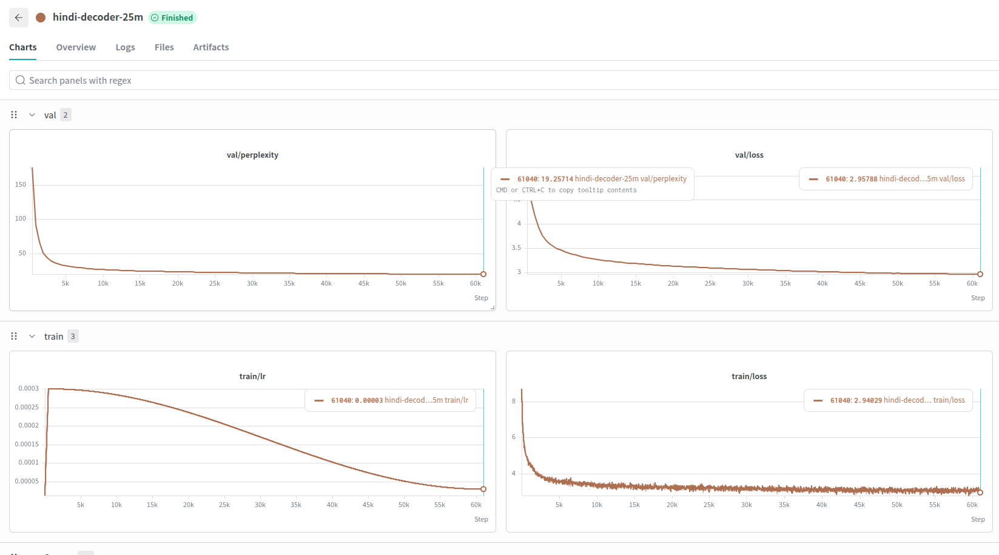
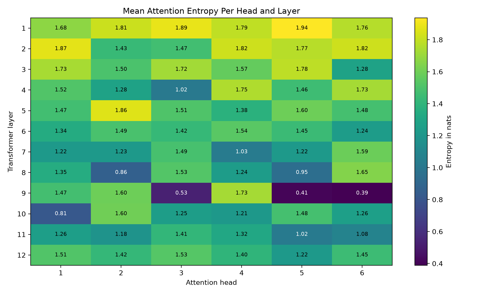
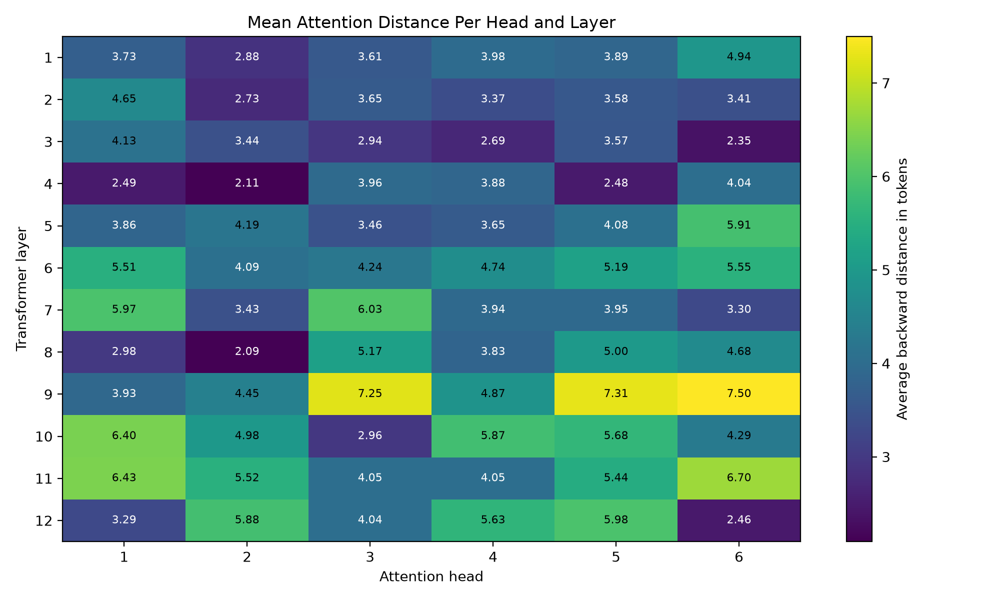

# Phase 2 Report

## One-Drive Language Model files link
[LMA_phase2](https://iiithydresearch-my.sharepoint.com/:f:/g/personal/jayanth_raju_research_iiit_ac_in/IgAeoRhtYHcaQLMnfDTLQyKoAS2VRVExQNLMWlCTbarPLPo?e=xo0Gm4)

## WANDB training stuff

### Hindi


### Nepali


## 2.2 Configuration and Reporting

**Hyperparameters (Model H & Model L)**:
- **d_model (dimension)**: 384
- **Number of layers**: 12
- **Number of heads**: 6
- **Feed-forward width (d_ff)**: 1600
- **Context length**: 512
- **Dropout**: 0.1
- **Vocabulary Size**: 8,000 (Model H - Hindi) / 10,000 (Model L - Nepali)

**Exact Parameter Count**:
- **Model H (Hindi)**: 24,956,928 trainable parameters
- **Model L (Nepali)**: 25,724,928 trainable parameters

*Note: The ~768K difference in parameter count arises because the vocabulary sizes differ (8,000 vs 10,000) and the input embedding layer is tied to the output projection layer.*

**Depth/Width Trade-off Justification**:
Given the constraint of approximately 25M parameters, we opted for a deep-narrow configuration (12 layers, 384 d_model) rather than a shallow-wide one (e.g., 6 layers, 512 d_model). Deeper networks are generally more effective at hierarchical feature extraction and compositional reasoning. A narrower dimension (384) with a healthy feed-forward expansion (1600) ensures sufficient representational capacity at each layer while remaining within the tight parameter budget.

**Component Explanations**:
- **Token Embedding**: Computes a dense vector for each token in the vocabulary (Shape: `[vocab_size, d_model]`). If removed, the model wouldn't be able to map discrete input tokens into the continuous vector space required by the transformer.
- **Position Embedding**: Computes an additive vector that encodes the position of each token (Shape: `[context_length, d_model]`). If removed, the transformer would lose all notion of token order, treating sequences merely as bags-of-words.
- **Multi-Head Attention**: Computes self-attention by projecting inputs into Query, Key, and Value tensors, then calculating scaled dot-product attention (Shape of Q/K/V: `[batch, heads, seq_len, head_dim]`). If removed, the model would have no mechanism for tokens to interact with or contextualize based on other tokens in the sequence.
- **Feed-Forward Network (FFN)**: Computes a two-layer non-linear transformation over each token independently (Inner shape: `[batch, seq_len, d_ff]`). If removed, the model's ability to memorize and process complex, non-linear representations of individual tokens would be severely handicapped.
- **Layer Normalization**: Computes mean and variance across the embedding dimension to stabilize activations (Shape: `[d_model]`). If removed, the training would become highly unstable due to vanishing/exploding gradients.
- **Output Projection**: Computes the final logits over the vocabulary (Shape: `[d_model, vocab_size]`). If removed, the model couldn't produce probability distributions for predicting the next token.

## 2.3 Language Modeling and Attention Evaluation

### Intrinsic Language-Modeling Metrics

| Metric | Model H (Hindi) | Model L (Nepali) |
|---|---|---|
| Validation Cross-Entropy Loss | 2.97 | 3.17 |
| Validation Perplexity | 19.58 | 23.75 |
| Validation BPB | 0.480 | 0.422 |
| Test Cross-Entropy Loss | 3.00 | 3.15 |
| Test Perplexity | 20.13 | 23.34 |
| Test BPB | 0.485 | 0.416 |

**Discussion on the Gap**:
Model L (Nepali) yields a higher perplexity (~23.3 vs ~20.1) than Model H (Hindi), meaning it is slightly more uncertain per-token. However, it achieves a lower Bits-Per-Byte (BPB) (0.416 vs 0.485). This discrepancy primarily stems from tokenizer fertility. The Nepali tokenizer (vocab of 10K) compresses raw text more efficiently than the Hindi tokenizer (vocab of 8K) per byte. BPB normalizes out these tokenization differences by measuring the information content over the raw bytes of the text rather than arbitrary tokens. At the byte level, the Nepali model compresses the text better, which might be attributed to the quality/domain of the training data or the specific byte structure of the script.

### Generation Quality

| Model | Decoding | BLEU-4 | chrF++ | ROUGE-L | Repeat-3 | Distinct-1 | Distinct-2 |
|---|---|---|---|---|---|---|---|
| **Model H** | Greedy | 4.66 | 15.54 | 0.0226 | 0.5907 | 0.1369 | 0.2824 |
| | T=0.5 | 5.04 | 18.07 | 0.0202 | 0.2705 | 0.1945 | 0.4901 |
| | T=1.0 | 3.30 | 18.03 | 0.0259 | 0.0218 | 0.3248 | 0.8129 |
| | T=1.5 | 2.11 | 16.39 | 0.0152 | 0.0010 | 0.4728 | 0.9731 |
| **Model L** | Greedy | 2.02 | 18.36 | 0.0029 | 0.6014 | 0.1475 | 0.2859 |
| | T=0.5 | 1.88 | 19.71 | 0.0022 | 0.3129 | 0.2167 | 0.4910 |
| | T=1.0 | 1.05 | 19.15 | 0.0015 | 0.0237 | 0.3893 | 0.8472 |
| | T=1.5 | 0.22 | 16.65 | 0.0000 | 0.0010 | 0.5366 | 0.9738 |

**Metric Informativeness**:
- **BLEU & ROUGE-L**: Poor metrics for open-ended generation. They demand exact n-gram/subsequence overlap with a single reference continuation. Language allows for many valid, diverse continuations, and these metrics severely penalize creative but valid text.
- **chrF/chrF++**: Slightly more robust since it relies on character n-grams. It handles morphological variations better (important for rich morphologies in Hindi/Nepali) but still suffers from the single-reference penalty.

**Fluency and Diversity Diagnostics (Qualitative Notes)**:
- **Greedy Decoding**: Models form locally coherent initial phrases but rapidly degenerate into infinite repetition loops.
  - *Hindi Example Prefix*: "स्पोर्ट्स डेस्क- भारतीय क्रिकेट में शिखर धवन को कौन नहीं जानता, वर्ल्ड क्रिकेट में अपनी एक अलग ही पहचान बनाकर रखे हुए हैं शिखर धवन, तो वहीं भारतीय वि"
  - *Hindi Greedy Generation*: "श्लेषक रोहित शर्मा ने भी इस बात की पुष्टि की है कि वह इस साल के अंत में होने वाले वर्ल्ड कप में भी शिखर धवन को नहीं जानते। रोहित शर्मा ने कहा कि वह इस साल के अंत में होने वाले वर्ल्ड कप में भी शिखर धवन को नहीं जानते। रोहित शर्मा ने कहा कि वह इस साल के अंत" (Local grammatical coherence but gets stuck repeating Rohit Sharma's quote).
  - *Nepali Example Prefix*: "सोल, बैशाख 23 । गुल्मी सम्पर्क समिति दक्षिण कोरियाले सातौँ रेसुंगा खुल्ला भलिवल प्रतियोगिता आयोजना गर्ने भएको छ । दक्षिण"
  - *Nepali Greedy Generation*: "कोरियाको सोलमा रहेको सोलमा रहेको सोलमा रहेको सोलमा रहेको सोलमा रहेको सोलमा रहेको सोलमा रहेको..." (Immediate repetition loop of "in Seoul").
- **Temperature 1.0**: Eliminates severe repetitions and maintains high vocabulary diversity. The generated text stays somewhat on-topic domain-wise but tends to drift semantically and hallucinate nonsensical connections over longer sequences.
  - *Hindi T=1.0 Generation (same prefix)*: "मेन, हैरी ब्रुक को भी क्यों नहीं देखते कि बाघ और शिव लाल ये सिर्फ यादगार शटल है. पर अभी इनको कोई नहीं जानता और भारत में भी इन्हें याद नहीं रहता. क्रिकेट भारत को इस मास्टर कोच को लाना हर किसी के लिए मुश्किल जैसी नहीं है..." (Varied vocabulary, stays in sports domain with "Harry Brook", "coach", but loses logical coherence).
  - *Nepali T=1.0 Generation (same prefix)*: "कोरिया पठाउन नेपाली राजनितीक पहल, सञ्चार र पर्यटनलाई लक्षित गरि रेसुंगा खुल्ला भलिवल प्रतियोगिता गरिएको गुल्मी सम्पर्क समितिले जनाएको छ । रेसुंगा खुल्ला भलिवल प्रतियोगिता विरलै हुने सो अवसरमा जापान सरकारले काठमाडौ विश्वविद्यालयलाई भ्रमणको लागि १० लाख सिकाउने..." (Maintains long-context vocabulary like "tourism", "committee" but hallucinates facts about the Japanese government and Kathmandu University).
- **Temperature 1.5**: Pushes diversity to extreme levels but completely degenerates into incoherent gibberish.

### Attention Analysis

**Attention Heatmaps & Statistics**
*(The generated heatmaps are available in the respective `attention_analysis` directories)*

* Hindi Heatmaps:
  - 
  - 
* Nepali Heatmaps:
  - 
  - 
* Aggregate Statistics:
  - 
  - 
  - 
  - 

**Discussion**:
- **Local vs. Long-range Heads**: By analyzing attention entropy and mean distance, we observe that early layers (e.g., Layer 1) generally have high entropy (~1.6 - 1.9) and moderate attention distances, indicating diffuse, broad attention as the model builds initial token representations.
- **Content-based Heads**: In middle-to-late layers (e.g., Layer 9), highly specialized heads emerge. For example, in Model H's Layer 9, Heads 5 and 6 have very low entropy (0.40 and 0.38) but very high mean attention distances (7.3 - 7.5 tokens). These are content-based heads that confidently attend to specific distant tokens (like tracking entities or structural dependencies).
- **Positional Heads**: Some heads remain strictly local. In Model L's Layer 3, Head 5 has a mean distance of just 1.65, functioning primarily to look at the immediate preceding token.
- **Model H vs. Model L Differences**: Both models exhibit similar layer-wise progression (diffuse -> specialized -> mixed output formulation). Model H tends to develop slightly more distinct low-entropy, long-range heads in Layer 9, while Model L develops them slightly deeper (Layer 11).

---
*(Original Log Outputs appended below)*

``` text
Intrinsic Metrics:

python -m hindi.training.intrinsic_metrics   --checkpoint hindi/training/checkpoints/best.pt   --output hindi/training/checkpoints/intrinsic_metrics_best.json --max-tokens 1000000
Evaluating validation: 100%|███████████████████████████████████████████████████████████████████████████████████████████████████████████████████████████████████████████████████████████████████████| 62/62 [05:01<00:00,  4.87s/batch]
validation: loss=2.974667 ppl=19.5831 bpb=0.480417
Evaluating test: 100%|█████████████████████████████████████████████████████████████████████████████████████████████████████████████████████████████████████████████████████████████████████████████| 62/62 [07:35<00:00,  7.34s/batch]
test: loss=3.002461 ppl=20.1350 bpb=0.485165

python -m nepali.training.intrinsic_metrics   --checkpoint nepali/training/checkpoints/best.pt   --output nepali/training/checkpoints/intrinsic_metrics_best.json --max-tokens 1000000
Evaluating validation: 100%|███████████████████████████████████████████████████████████████████████████████████████████████████████████████████████████████████████████████████████████████████████| 62/62 [05:08<00:00,  4.97s/batch]
validation: loss=3.167634 ppl=23.7512 bpb=0.422058
Evaluating test: 100%|█████████████████████████████████████████████████████████████████████████████████████████████████████████████████████████████████████████████████████████████████████████████| 62/62 [07:25<00:00,  7.18s/batch]
test: loss=3.150161 ppl=23.3398 bpb=0.416501

Generation Quality:

venv/bin/python generation_quality.py   --language nepali   --checkpoint nepali/training/checkpoints/best.pt   --num-examples 100   --prefix-tokens 32   --continuation-tokens 64   --output-dir nepali/training/generation_quality
Generating greedy: 100%|███████████████████████████████████████████████████████████████████████████████████████████████████████████████████████████████████████████████████████████████████████| 100/100 [00:48<00:00,  2.05example/s]
Generating sample_t0.5: 100%|██████████████████████████████████████████████████████████████████████████████████████████████████████████████████████████████████████████████████████████████████| 100/100 [00:47<00:00,  2.10example/s]
Generating sample_t1: 100%|████████████████████████████████████████████████████████████████████████████████████████████████████████████████████████████████████████████████████████████████████| 100/100 [07:42<00:00,  4.62s/example]
Generating sample_t1.5: 100%|██████████████████████████████████████████████████████████████████████████████████████████████████████████████████████████████████████████████████████████████████| 100/100 [04:50<00:00,  2.90s/example]
Saved aggregate metrics: nepali/training/generation_quality/generation_metrics.json
Saved qualitative outputs: nepali/training/generation_quality/generations.jsonl
greedy: BLEU-4=2.02, chrF++=18.36, ROUGE-L=0.0029, repeat-3=0.6014, D-1=0.1475, D-2=0.2859
sample_t0.5: BLEU-4=1.88, chrF++=19.71, ROUGE-L=0.0022, repeat-3=0.3129, D-1=0.2167, D-2=0.4910
sample_t1: BLEU-4=1.05, chrF++=19.15, ROUGE-L=0.0015, repeat-3=0.0237, D-1=0.3893, D-2=0.8472
sample_t1.5: BLEU-4=0.22, chrF++=16.65, ROUGE-L=0.0000, repeat-3=0.0010, D-1=0.5366, D-2=0.9738

venv/bin/python generation_quality.py   --language hindi   --checkpoint hindi/training/checkpoints/best.pt   --num-examples 100   --prefix-tokens 32   --continuation-tokens 64   --output-dir hindi/training/generation_quality
Generating greedy: 100%|███████████████████████████████████████████████████████████████████████████████████████████████████████████████████████████████████████████████████████████████████████| 100/100 [00:49<00:00,  2.01example/s]
Generating sample_t0.5: 100%|██████████████████████████████████████████████████████████████████████████████████████████████████████████████████████████████████████████████████████████████████| 100/100 [02:48<00:00,  1.69s/example]
Generating sample_t1: 100%|████████████████████████████████████████████████████████████████████████████████████████████████████████████████████████████████████████████████████████████████████| 100/100 [05:20<00:00,  3.21s/example]
Generating sample_t1.5: 100%|██████████████████████████████████████████████████████████████████████████████████████████████████████████████████████████████████████████████████████████████████| 100/100 [04:44<00:00,  2.85s/example]
Saved aggregate metrics: hindi/training/generation_quality/generation_metrics.json
Saved qualitative outputs: hindi/training/generation_quality/generations.jsonl
greedy: BLEU-4=4.66, chrF++=15.54, ROUGE-L=0.0226, repeat-3=0.5907, D-1=0.1369, D-2=0.2824
sample_t0.5: BLEU-4=5.04, chrF++=18.07, ROUGE-L=0.0202, repeat-3=0.2705, D-1=0.1945, D-2=0.4901
sample_t1: BLEU-4=3.30, chrF++=18.03, ROUGE-L=0.0259, repeat-3=0.0218, D-1=0.3248, D-2=0.8129
sample_t1.5: BLEU-4=2.11, chrF++=16.39, ROUGE-L=0.0152, repeat-3=0.0010, D-1=0.4728, D-2=0.9731
```