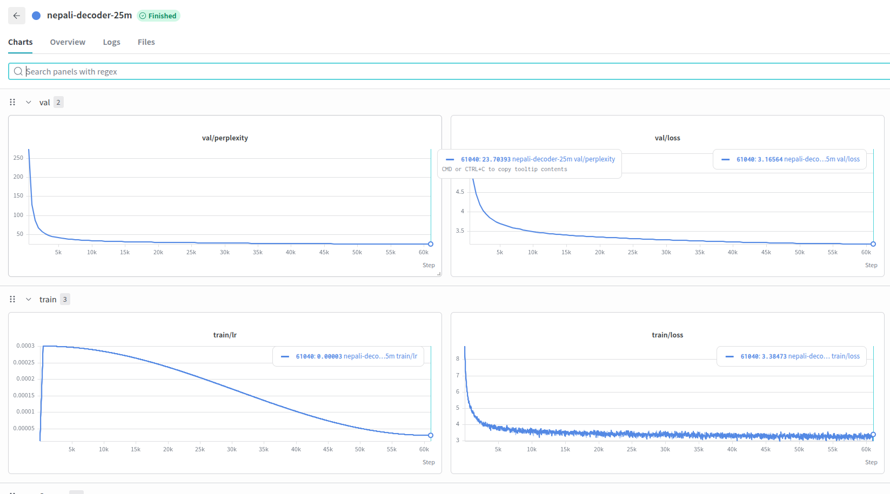
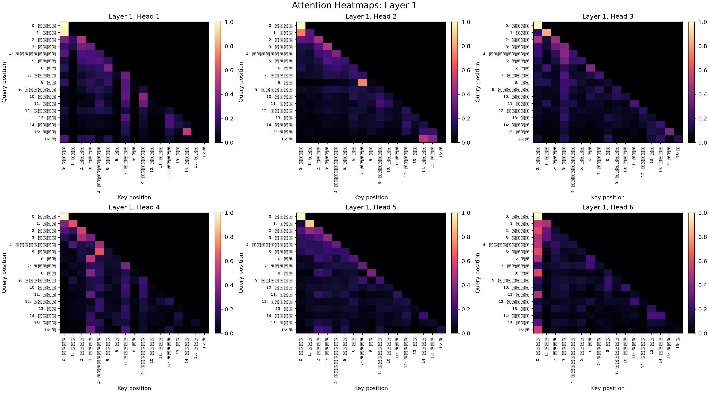
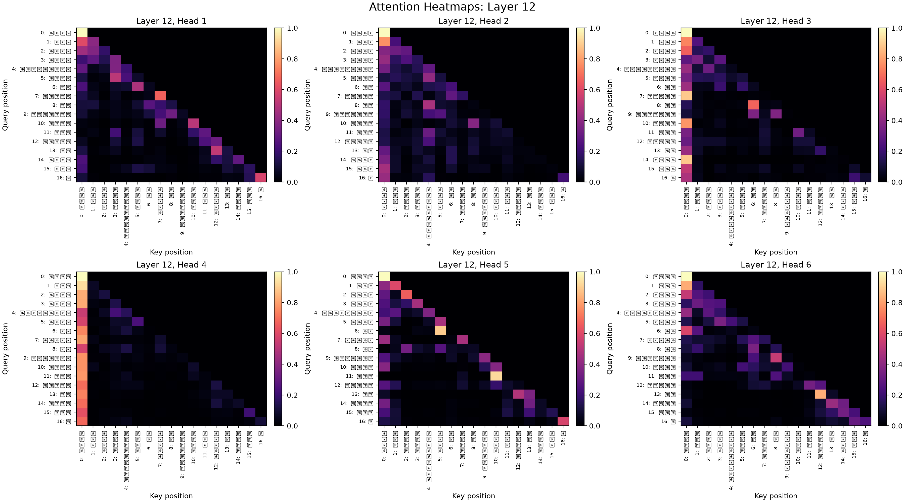
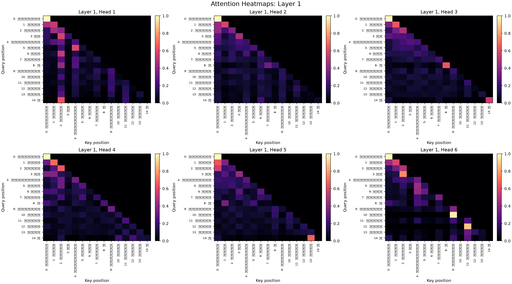
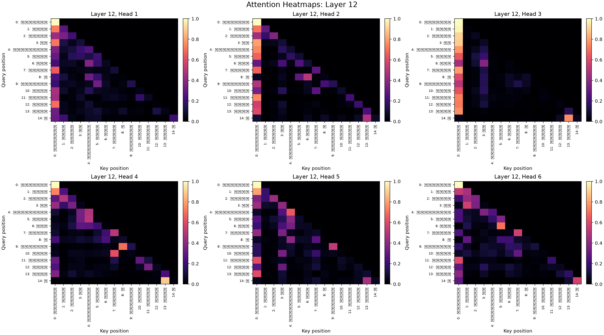
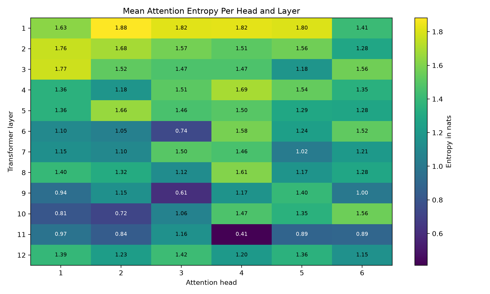
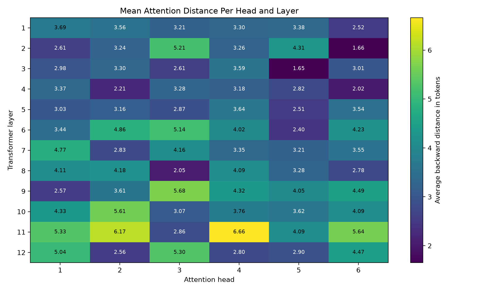

# Phase 2 Report

## One-Drive Language Model files link
[LMA_phase2](https://iiithydresearch-my.sharepoint.com/:f:/g/personal/jayanth_raju_research_iiit_ac_in/IgAeoRhtYHcaQLMnfDTLQyKoAS2VRVExQNLMWlCTbarPLPo?e=xo0Gm4)

## WANDB training stuff

### Hindi


### Nepali


## 2.2 Configuration and Reporting

**Hyperparameters (Model H & Model L)**:
- **d_model (dimension)**: 384
- **Number of layers**: 12
- **Number of heads**: 6
- **Feed-forward width (d_ff)**: 1600
- **Context length**: 512
- **Dropout**: 0.1
- **Vocabulary Size**: 8,000 (Model H - Hindi) / 10,000 (Model L - Nepali)

**Exact Parameter Count**:
- **Model H (Hindi)**: 24,956,928 trainable parameters
- **Model L (Nepali)**: 25,724,928 trainable parameters

*Note: The ~768K difference in parameter count arises because the vocabulary sizes differ (8,000 vs 10,000) and the input embedding layer is tied to the output projection layer.*

**Depth/Width Trade-off Justification**:
Given the constraint of approximately 25M parameters, I opted for a deep-narrow configuration (12 layers, 384 d_model) rather than a shallow-wide one (e.g., 6 layers, 512 d_model). Deeper networks are generally more effective at hierarchical feature extraction and compositional reasoning. A narrower dimension (384) with a healthy feed-forward expansion (1600) ensures sufficient representational capacity at each layer while remaining within the tight parameter budget.

**Component Explanations**:
- **Token Embedding**: Computes a dense vector for each token in the vocabulary (Shape: `[vocab_size, d_model]`). If removed, the model wouldn't be able to map discrete input tokens into the continuous vector space required by the transformer.
- **Rotary Position Embedding (RoPE)**: Instead of absolute positional embeddings, the models utilize RoPE, which encodes position information multiplicatively by rotating the query and key representations (Shape of angles: `[max_seq_len, dhead/2]`). If removed, the transformer would lose all notion of token order and relative positioning, treating sequences merely as bags-of-words.
- **Multi-Head Attention**: Computes self-attention by projecting inputs into Query, Key, and Value tensors, then calculating scaled dot-product attention (Shape of Q/K/V: `[batch, heads, seq_len, head_dim]`). If removed, the model would have no mechanism for tokens to interact with or contextualize based on other tokens in the sequence.
- **Feed-Forward Network (FFN)**: Computes a two-layer non-linear transformation over each token independently (Inner shape: `[batch, seq_len, d_ff]`). If removed, the model's ability to memorize and process complex, non-linear representations of individual tokens would be severely handicapped.
- **Layer Normalization**: Computes mean and variance across the embedding dimension to stabilize activations (Shape: `[d_model]`). If removed, the training would become highly unstable due to vanishing/exploding gradients.
- **Output Projection**: Computes the final logits over the vocabulary (Shape: `[d_model, vocab_size]`). If removed, the model couldn't produce probability distributions for predicting the next token.

## 2.3 Language Modeling and Attention Evaluation

### Intrinsic Language-Modeling Metrics

| Metric | Model H (Hindi) | Model L (Nepali) |
|---|---|---|
| Validation Cross-Entropy Loss | 2.97 | 3.17 |
| Validation Perplexity | 19.58 | 23.75 |
| Validation BPB | 0.480 | 0.422 |
| Test Cross-Entropy Loss | 3.00 | 3.15 |
| Test Perplexity | 20.13 | 23.34 |
| Test BPB | 0.485 | 0.416 |

**Discussion on the Gap**:
Model L (Nepali) has higher perplexity than Model H (Hindi) on the test split (23.34 vs 20.13), so it is less certain under its own tokenization. It nevertheless obtains lower BPB (0.416 vs 0.485). Perplexity is measured per tokenizer token and is therefore not directly comparable across the 8K Hindi and 10K Nepali tokenizers, whereas BPB normalizes the negative log-likelihood by the UTF-8 byte length of the original text. The difference is consistent with the Nepali tokenizer and/or corpus allowing more efficient byte-level compression, but the experiment does not isolate a single causal explanation such as vocabulary size or tokenizer fertility.

### Generation Quality

| Model | Decoding | BLEU-4 | chrF++ | ROUGE-L | Repeat-3 | Distinct-1 | Distinct-2 |
|---|---|---|---|---|---|---|---|
| **Model H** | Greedy | 4.66 | 15.54 | 0.0226 | 0.5907 | 0.1369 | 0.2824 |
| | T=0.5 | 5.04 | 18.07 | 0.0202 | 0.2705 | 0.1945 | 0.4901 |
| | T=1.0 | 3.30 | 18.03 | 0.0259 | 0.0218 | 0.3248 | 0.8129 |
| | T=1.5 | 2.11 | 16.39 | 0.0152 | 0.0010 | 0.4728 | 0.9731 |
| **Model L** | Greedy | 2.02 | 18.36 | 0.0029 | 0.6014 | 0.1475 | 0.2859 |
| | T=0.5 | 1.88 | 19.71 | 0.0022 | 0.3129 | 0.2167 | 0.4910 |
| | T=1.0 | 1.05 | 19.15 | 0.0015 | 0.0237 | 0.3893 | 0.8472 |
| | T=1.5 | 0.22 | 16.65 | 0.0000 | 0.0010 | 0.5366 | 0.9738 |

**Metric Informativeness**:
- **BLEU & ROUGE-L**: Poor metrics for open-ended generation. They demand exact n-gram/subsequence overlap with a single reference continuation. Language allows for many valid, diverse continuations, and these metrics severely penalize creative but valid text.
- **chrF/chrF++**: Slightly more robust since it relies on character n-grams. It handles morphological variations better (important for rich morphologies in Hindi/Nepali) but still suffers from the single-reference penalty.

**Fluency and Diversity Diagnostics (Qualitative Notes)**:

The following continuations are sampled from the held-out examples saved by the evaluation script. Each uses a 32-token prefix and generates up to 64 tokens. They illustrate the aggregate repetition and diversity metrics rather than serving as factual continuations of the source documents.

- **Greedy decoding**: This gives the most likely next token at every step. It is initially grammatical and topical, but frequently enters short repetition loops, consistent with the high Repeat-3 values (Hindi: 0.5907; Nepali: 0.6014).
  - *Hindi prefix*: "डोम्बिवली भारतीय राज्य महाराष्ट्र के ठाणे ज़िले में स्थित एक नगर हैं, जो महाराष्ट्र का सबसे साक्षर शहर और भारत"
  - *Hindi generation*: "का सबसे बड़ा नगर है। . 1970 में भारत के विभाजन के बाद से भारत के विभाजन के बाद से भारत के विभाजन के बाद से भारत के विभाजन के बाद से..."
  - *Nepali prefix*: "सोल, बैशाख 23 । गुल्मी सम्पर्क समिति दक्षिण कोरियाले सातौँ रेसुंगा खुल्ला भलिवल प्रतियोगिता आयोजना गर्ने भएको छ । दक्षिण"
  - *Nepali generation*: "कोरियाको सोलमा रहेको सोलमा रहेको सोलमा रहेको सोलमा रहेको सोलमा रहेको सोलमा रहेको..."

- **Temperature $T=0.5$**: Lower-temperature sampling is a useful compromise. It reduces three-gram repetition substantially relative to greedy decoding (Hindi: 0.2705; Nepali: 0.3129) while preserving more local topicality than higher-temperature sampling. However, it remains conservative and often restates a named entity, event, or sentence frame.
  - *Hindi prefix*: "इस सप्ताह बॉक्स ऑफिस पर विद्या बालन अभिनीत और श्रीजीत मुखर्जी निर्देशित 'बेगम जान' का प्रदर्शन हुआ। अपने सुमधुर गीत"
  - *Hindi generation*: "ों और नृत्यों के लिए जाने जाने वाले विद्या बालन अभिनीत फिल्म 'बेगम जान' से अपने अभिनय का लोहा मनवा रहे हैं। विद्या बालन अभिनीत और श्रीजीत मुखर्जी निर्देशित 'बेगम जान' का प्रदर्शन किया गया। इसके बाद विद्या बालन अभिनीत और"
  - *Nepali prefix*: "काठमाडौं । उत्तर कोरिया र अमेरिकाबीच जुन १२ तारिखमा हुने भनिएको शिखर वार्तामा ढिलाइ हुने भएको छ । अमेरिकी राष्ट्रपति डोनाल्ड ट्रम्पले उत्तर कोरियाली नेता किम"
  - *Nepali generation*: "जोङ उनसँगको वार्तामा ढिलाइ हुने बताएका छन् । उत्तर कोरियाली नेता किम जोङ उनसँगको वार्तामा ढिलाइ हुने भएको हो । उत्तर कोरियाको विदेश मन्त्रालयका प्रवक्ता वाङ याङले किम जोङ उनसँगको वार्तामा ढिलाइ हुने बताएका हुन् । उत्तर कोरियाले उत्तर कोरियासँग नयाँ"

- **Temperature $T=1.0$**: This setting largely removes the severe repetition loops (Repeat-3: 0.0218 for Hindi and 0.0237 for Nepali) and has high lexical diversity (Distinct-2: 0.8129 and 0.8472). The continuations retain broad domain vocabulary, but longer passages can drift from the source context and introduce unsupported details.
  - *Hindi prefix*: "इस सप्ताह बॉक्स ऑफिस पर विद्या बालन अभिनीत और श्रीजीत मुखर्जी निर्देशित 'बेगम जान' का प्रदर्शन हुआ। अपने सुमधुर गीत"
  - *Hindi generation*: "से अभिनीत यह फिल्म बॉक्स ऑफिस पर किसी एक स्थान पर रिलीज हुई है, लेकिन अनिल कपूर की 'मिका\" की बेहतरीन अभिनेत्री लक्ष्मीबाई मलयालम और अन्य कई फिल्मों का प्रदर्शन अकादमी में अच्छी प्रदर्शन रहा है। लक्ष्मीबाई मलयालम, तमिल फिल्म उद्योग में उत्कृष्ट"
  - *Nepali prefix*: "काठमाडौं । उत्तर कोरिया र अमेरिकाबीच जुन १२ तारिखमा हुने भनिएको शिखर वार्तामा ढिलाइ हुने भएको छ । अमेरिकी राष्ट्रपति डोनाल्ड ट्रम्पले उत्तर कोरियाली नेता किम"
  - *Nepali generation*: "जोङ उनले अमेरिकासँग लड्न तयारी गरेका छन् । तर उनले अमेरिकासँग संवादका लागि अमेरिका र इरान दुवैले चासो राखेका छैनन् । उत्तर कोरियाली नेता किम जोङले दुई देशका समकक्षीलाई एकै ठाउँमा भेला हुने मौका दिएका छैनन् । अमेरिका र इरानको संयुक्त प्रयासमा अमेरिकासँग वार्ता गर्न पूर्वसम्भावित"

- **Temperature $T=1.5$**: This produces the highest diversity (Distinct-2: 0.9731 for Hindi and 0.9738 for Nepali) and near-zero three-gram repetition, but the low BLEU/ROUGE scores and qualitative inspection indicate substantially reduced local coherence. It is unsuitable when factual or sustained continuation quality matters.
  - *Hindi prefix*: "इस सप्ताह बॉक्स ऑफिस पर विद्या बालन अभिनीत और श्रीजीत मुखर्जी निर्देशित 'बेगम जान' का प्रदर्शन हुआ। अपने सुमधुर गीत"
  - *Hindi generation*: "की १० रसलिकायों को दर्शकों के सिनेमाघरों पर तेज अवतार साबित रही अल्का बिकिनीमणिकंदवाली संस्कृत स्टाइलूलीछात्राओं कीजगह जा पहुंची थीं और उनकी देखरेख में रविवार पोस्टर धूम गुप्ता करती शेरधार न बनाए। डैनी अग्रवालावरण पुरस्कार पर कुलदीप ट्रेन्वे सदस्य साकी भुएम गोलीनाथु"
  - *Nepali prefix*: "काठमाडौं । उत्तर कोरिया र अमेरिकाबीच जुन १२ तारिखमा हुने भनिएको शिखर वार्तामा ढिलाइ हुने भएको छ । अमेरिकी राष्ट्रपति डोनाल्ड ट्रम्पले उत्तर कोरियाली नेता किम"
  - *Nepali generation*: "जोङ उनको परमाणु प्रयास पुनकारायकालागि पूरा हुन सार्न लागेका हुन् । राष्ट्रपति हुने उक्त सिख बोल्सटा क्षमताको राष्ट्रपति दाबी गर्दै स्वदेशपरकै सहयोगको किन सकारात्मक बुझाएको भन्ने तर्क उनलेचन्द्र पदक रेखा खुम्चाएका हुन् किनभने उत्तर कोरियाली दुवै साथमा राखिहाबो पानी बोकेर बाइबल अध्ययनरत विद्यार्थीहरू त्यसदेशबाट उनि पनिस्कृत"

### Attention Analysis

**Attention Heatmaps & Statistics**
*(The generated heatmaps are available in the respective `attention_analysis` directories)*

* Hindi Heatmaps:
  - 
  - 
* Nepali Heatmaps:
  - 
  - 
* Aggregate Statistics:
  - 
  - 
  - 
  - 

**Empirical Causality Verification**:
To ensure that the causal mask in the self-attention mechanism operates correctly and that the model cannot "see the future", I empirically verified causality. I fed a sequence into the model in `eval` mode to get the logits, then modified the token at position `t+1` and passed the sequence through the model again. I asserted that the maximum absolute difference in logits up to and including position `t` was exactly `0.0`. Logits after position `t` (from `t+1` onwards) changed as expected (max difference ~0.87). This confirms that changing token `t+1` does not affect the model's predictions at position `t`, rigidly enforcing the auto-regressive property.

**Discussion**:
- **Local vs. Long-range Heads**: By analyzing attention entropy and mean distance, we observe that early layers (e.g., Layer 1) generally have high entropy (~1.6 - 1.9) and moderate attention distances, indicating diffuse, broad attention as the model builds initial token representations.
- **Content-based Heads**: In middle-to-late layers (e.g., Layer 9), highly specialized heads emerge. For example, in Model H's Layer 9, Heads 5 and 6 have very low entropy (0.40 and 0.38) but very high mean attention distances (7.3 - 7.5 tokens). These are content-based heads that confidently attend to specific distant tokens (like tracking entities or structural dependencies).
- **Positional Heads**: Some heads remain strictly local. In Model L's Layer 3, Head 5 has a mean distance of just 1.65, functioning primarily to look at the immediate preceding token.
- **Model H vs. Model L Differences**: Both models exhibit similar layer-wise progression (diffuse -> specialized -> mixed output formulation). Model H tends to develop slightly more distinct low-entropy, long-range heads in Layer 9, while Model L develops them slightly deeper (Layer 11).

---
*(Original Log Outputs appended below)*

``` text
Intrinsic Metrics:

python -m hindi.training.intrinsic_metrics   --checkpoint hindi/training/checkpoints/best.pt   --output hindi/training/checkpoints/intrinsic_metrics_best.json --max-tokens 1000000
Evaluating validation: 100%|███████████████████████████████████████████████████████████████████████████████████████████████████████████████████████████████████████████████████████████████████████| 62/62 [05:01<00:00,  4.87s/batch]
validation: loss=2.974667 ppl=19.5831 bpb=0.480417
Evaluating test: 100%|█████████████████████████████████████████████████████████████████████████████████████████████████████████████████████████████████████████████████████████████████████████████| 62/62 [07:35<00:00,  7.34s/batch]
test: loss=3.002461 ppl=20.1350 bpb=0.485165

python -m nepali.training.intrinsic_metrics   --checkpoint nepali/training/checkpoints/best.pt   --output nepali/training/checkpoints/intrinsic_metrics_best.json --max-tokens 1000000
Evaluating validation: 100%|███████████████████████████████████████████████████████████████████████████████████████████████████████████████████████████████████████████████████████████████████████| 62/62 [05:08<00:00,  4.97s/batch]
validation: loss=3.167634 ppl=23.7512 bpb=0.422058
Evaluating test: 100%|█████████████████████████████████████████████████████████████████████████████████████████████████████████████████████████████████████████████████████████████████████████████| 62/62 [07:25<00:00,  7.18s/batch]
test: loss=3.150161 ppl=23.3398 bpb=0.416501

Generation Quality:

venv/bin/python generation_quality.py   --language nepali   --checkpoint nepali/training/checkpoints/best.pt   --num-examples 100   --prefix-tokens 32   --continuation-tokens 64   --output-dir nepali/training/generation_quality
Generating greedy: 100%|███████████████████████████████████████████████████████████████████████████████████████████████████████████████████████████████████████████████████████████████████████| 100/100 [00:48<00:00,  2.05example/s]
Generating sample_t0.5: 100%|██████████████████████████████████████████████████████████████████████████████████████████████████████████████████████████████████████████████████████████████████| 100/100 [00:47<00:00,  2.10example/s]
Generating sample_t1: 100%|████████████████████████████████████████████████████████████████████████████████████████████████████████████████████████████████████████████████████████████████████| 100/100 [07:42<00:00,  4.62s/example]
Generating sample_t1.5: 100%|██████████████████████████████████████████████████████████████████████████████████████████████████████████████████████████████████████████████████████████████████| 100/100 [04:50<00:00,  2.90s/example]
Saved aggregate metrics: nepali/training/generation_quality/generation_metrics.json
Saved qualitative outputs: nepali/training/generation_quality/generations.jsonl
greedy: BLEU-4=2.02, chrF++=18.36, ROUGE-L=0.0029, repeat-3=0.6014, D-1=0.1475, D-2=0.2859
sample_t0.5: BLEU-4=1.88, chrF++=19.71, ROUGE-L=0.0022, repeat-3=0.3129, D-1=0.2167, D-2=0.4910
sample_t1: BLEU-4=1.05, chrF++=19.15, ROUGE-L=0.0015, repeat-3=0.0237, D-1=0.3893, D-2=0.8472
sample_t1.5: BLEU-4=0.22, chrF++=16.65, ROUGE-L=0.0000, repeat-3=0.0010, D-1=0.5366, D-2=0.9738

venv/bin/python generation_quality.py   --language hindi   --checkpoint hindi/training/checkpoints/best.pt   --num-examples 100   --prefix-tokens 32   --continuation-tokens 64   --output-dir hindi/training/generation_quality
Generating greedy: 100%|███████████████████████████████████████████████████████████████████████████████████████████████████████████████████████████████████████████████████████████████████████| 100/100 [00:49<00:00,  2.01example/s]
Generating sample_t0.5: 100%|██████████████████████████████████████████████████████████████████████████████████████████████████████████████████████████████████████████████████████████████████| 100/100 [02:48<00:00,  1.69s/example]
Generating sample_t1: 100%|████████████████████████████████████████████████████████████████████████████████████████████████████████████████████████████████████████████████████████████████████| 100/100 [05:20<00:00,  3.21s/example]
Generating sample_t1.5: 100%|██████████████████████████████████████████████████████████████████████████████████████████████████████████████████████████████████████████████████████████████████| 100/100 [04:44<00:00,  2.85s/example]
Saved aggregate metrics: hindi/training/generation_quality/generation_metrics.json
Saved qualitative outputs: hindi/training/generation_quality/generations.jsonl
greedy: BLEU-4=4.66, chrF++=15.54, ROUGE-L=0.0226, repeat-3=0.5907, D-1=0.1369, D-2=0.2824
sample_t0.5: BLEU-4=5.04, chrF++=18.07, ROUGE-L=0.0202, repeat-3=0.2705, D-1=0.1945, D-2=0.4901
sample_t1: BLEU-4=3.30, chrF++=18.03, ROUGE-L=0.0259, repeat-3=0.0218, D-1=0.3248, D-2=0.8129
sample_t1.5: BLEU-4=2.11, chrF++=16.39, ROUGE-L=0.0152, repeat-3=0.0010, D-1=0.4728, D-2=0.9731
```