# Language Modelling Individual Project Report

# Phase-1 Report

## Dataset Accumulation
### Prebuilt corpus
1. Sangraha Nepali Corpus - Extracted 500M words
2. Sangraha Hindi Corpus - Extracted 500M words

### Manual collection
#### Consideration
1. NewsPaper Scraping
2. Government sites Scraping
3. Literature scraping (if possible and if necessary)
4. Open subtitles (seems to be a good idea)

#### Actually done
Data extraction from common crawl which includes all kind
of scraping of the web over various domains.

Performed extraction of the URLs using the duckdb database and
got the warc record offsets and later extracted the relevant
text out of these sites using trafilatura efficiently.

## Cleaning and Pre-processing
1. Remove the extremely short docs. (like less than 100 words may be)
1. Remove Garbage docs (like 404 error or loading etc.,)
1. Remove repetitive docs (may be using hashing)
1. Unicode normalization (something like NFC)
1. Language identification using cld2 or 3 but may not necessary as common crawl already runs cld2
1. Score devanagri script ratio in the docs. (threshold like > 80 or > 90)
1. Remove gibberish as well
1. Character level quality filtering (give quality scoring based on these)
   - alphabetic character ratio
   - digits ratio
   - punctuation ratio
   - weird unicode ratio
   - repeated characters ratio
1. Normalize whitespaces (keep paragraph seperation or not ?)
1. Don't overclean punctuation and also normalize quotes
1. Normalize the english digits and devanagri ones (is there a reason to do or not do this ?)
1. Handle things like the Purna Viram (|) and Full Stop (.).
1. Replace URLs with \<URL\> may be for emails as well
1. Deduplication (remember to include the manual one in case of exact deduplication of records or something)
    - Paragraph dedup
    - Near duplicate removal using MinHash (sentence level as well)
    - Exact dedup
1. Perplexity based filtering (optional)
1. Once the document are clean, splitting them into sentences (may or may not be needed)
1. Safety filtering on the content

### Hindi Pre-processing runs
With Deduplication
```python
python3 ../cleaning/pipeline.py --input combined_hindi_corpus_copy.jsonl --output cleaned.jsonl
```

``` text
======================================================================
FINAL DATASET
======================================================================

TRAIN
  Total words:     357,154,414
  Estimated tokens:500,016,180
  Manual:          71,193,055
  Sangraha:        285,961,359
  Manual ratio:    19.933%

VALIDATION
  Total words:     70,867,645
  Estimated tokens:99,214,703
  Manual:          14,126,837
  Sangraha:        56,740,808
  Manual ratio:    19.934%

TEST
  Total words:     70,852,283
  Estimated tokens:99,193,196
  Manual:          14,118,622
  Sangraha:        56,733,661
  Manual ratio:    19.927%

======================================================================
FILES
======================================================================
splits/train.jsonl
splits/validation.jsonl
splits/test.jsonl
```

### Nepali runs
With Deduplication
```python
python3 ../cleaning/pipeline.py --input combined_nepali_corpus_copy.jsonl --output cleaned2.jsonl
```
```text
======================================================================
FINAL DATASET
======================================================================

TRAIN
  Total words:     357,143,405
  Estimated tokens:500,000,767
  Manual:          66,614,806
  Sangraha:        290,528,599
  Manual ratio:    18.652%

VALIDATION
  Total words:     70,507,150
  Estimated tokens:98,710,010
  Manual:          13,151,850
  Sangraha:        57,355,300
  Manual ratio:    18.653%

TEST
  Total words:     70,503,406
  Estimated tokens:98,704,768
  Manual:          13,149,352
  Sangraha:        57,354,054
  Manual ratio:    18.651%

======================================================================
FILES
======================================================================
splits/train.jsonl
splits/validation.jsonl
splits/test.jsonl
```

## Tokenization report
Chose unigram tokenizer for both as it seemed better to do a top down approach with all the matras and halants and all.
### Nepali
#### Evaluation Summary
| Dataset |        Vocab   |      Words   |     Tokens   |    UNK |  Fertility |  Chars/Tok  |   UNK Rate |  UNK Records
|-------------|----------|--------------|-----------------|---------|-----------|-----------|--------------|------------|
| test        |    4,000 |   70,503,406 |  133,766,591    |     0   | 1.897307  |    2.8894 |  0.000000%   |          0 |
| test        |    6,000 |   70,503,406 |  122,105,099    |     0   | 1.731904  |    3.1654 |  0.000000%   |          0 |
| test        |    8,000 |   70,503,406 |  115,490,552    |     0   | 1.638085  |    3.3467 |  0.000000%   |          0 |
| test        |   10,000 |   70,503,406 |  111,130,811    |     0   | 1.576247  |    3.4780 |  0.000000%   |          0 |
| test        |   12,000 |   70,503,406 |  108,119,964    |     0   | 1.533542  |    3.5748 |  0.000000%   |          0 |
| test        |   16,000 |   70,503,406 |  103,782,720    |     0   | 1.472024  |    3.7242 |  0.000000%   |          0 |
| validation  |    4,000 |   70,507,150 |  133,606,342    |     0   | 1.894933  |    2.8919 |  0.000000%   |          0 |
| validation  |    6,000 |   70,507,150 |  121,961,162    |     0   | 1.729770  |    3.1681 |  0.000000%   |          0 |
| validation  |    8,000 |   70,507,150 |  115,375,770    |     0   | 1.636370  |    3.3489 |  0.000000%   |          0 |
| validation  |   10,000 |   70,507,150 |  111,019,573    |     0   | 1.574586  |    3.4803 |  0.000000%   |          0 |
| validation  |   12,000 |   70,507,150 |  108,021,863    |     0   | 1.532070  |    3.5769 |  0.000000%   |          0 |
| validation  |   16,000 |   70,507,150 |  103,688,016    |     0   | 1.470603  |    3.7264 |  0.000000%   |          0 |

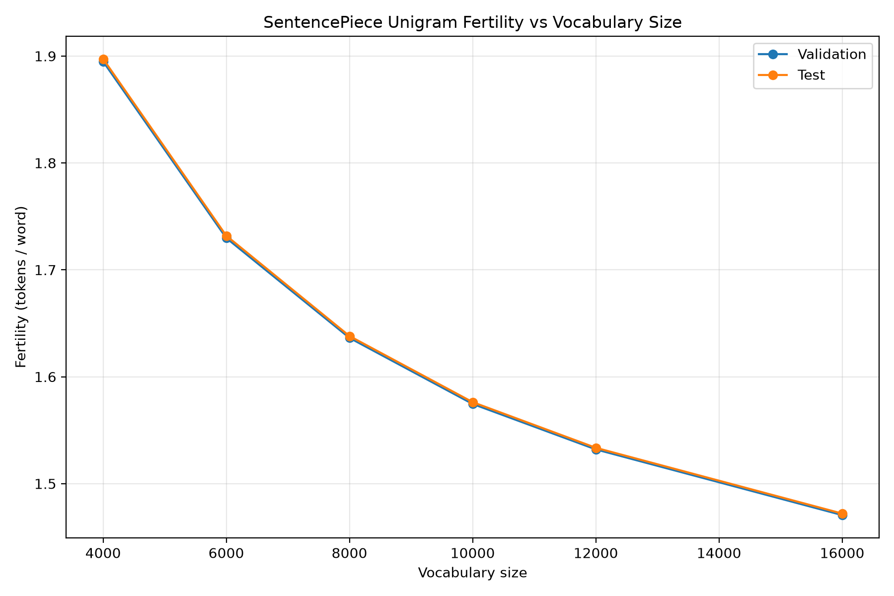

#### For the chosen 10K vocab model (keeping the model parameter constraint in mind)

Frequent Tokens Stats

| token | count | frequency (%) |
|-------|-------|---------------|
| ▁|7772811|0.06994289819409309|
| ।|4414477|0.039723250107479194|
| को|2495660|0.022456958403731977|
| ","|2119504|0.01907215452607468|
| मा|1991742|0.017922500358608918|
| ▁र|1401568|0.012611875927010017|
| ▁छ|1336893|0.012029904110031195|
| का|1214738|0.010930703997112016|
| ले|1211461|0.010901216225264477|
| लाई|712527|0.006411606228627271|
| ▁पनि|619457|0.005574124713262464|
| '|575270|0.005176512209561757|
| -|468585|0.0042165174156787175|
| ▁छन्|454483|0.0040896219141242475|
| न|452279|0.0040697894304037785|

Examples

================================================================================
Example 1
Text:
काठमाडौं । उत्तर कोरिया र अमेरिकाबीच जुन १२ तारिखमा हुने भनिएको शिखर वार्तामा ढिलाइ हुने भएको छ । अमेरिकी राष्ट्रपति डोनाल्ड ट्रम्पले उत्तर कोरियाली नेता किम जोङ-उनसँगको ऐतिहासिक शिखर वार्तामा केही ढिलाई हुनसक्ने बताए ।
 वार्ताका विषयमा छलफल गर्न ह्वाइट हाउसमा पुगेका दक्षिण कोरियाका राष्ट्रपति मून जेइनसँग कुरा गर्दै राष्ट्रपति ट्रम्पले वार्तामा केही ढिलाई हुनसक्ने बताएका हुन् ।
 उत्तर कोरियाले निश्चित सर्तहरु पूरा नगरे उक्त शिखर बैठक पर सर्ने ट्रम्पको भनाइ थियो । उनले अहिलेको स्थितिमा उत्तर कोरियासँग वार्ता हुन नसके त्यसपछि कहिल्यै हुन नसक्ने पनि बताएका छन् ।
 वार्ताका लागि अमेरिकाले उत्तर कोरियासँग परमाणु हतियार नष्ट गर्न लगातार दबाब दिँदै आएको छ । अघिल्लो हप्ता उत्तर कोरियाले अमेरिकाले परमाणु हतियारको विषयलाई लिएर एकतर्फी दबाब दिइरहे वार्ता रद्द पनि हुनसक्ने बताएको थियो ।

Words: 123
Pieces:
▁काठमाडौं | ▁ | । | ▁उत्तर | ▁कोरिया | ▁र | ▁अमेरिका | बीच | ▁जुन | ▁१२ | ▁तारिख | मा | ▁हुने | ▁भनिएको | ▁शिखर | ▁वार्ता | मा | ▁ढिलाइ | ▁हुने | ▁भएको | ▁छ | ▁ | । | ▁अमेरिकी | ▁राष्ट्रपति | ▁डोनाल्ड | ▁ट्रम्पले | ▁उत्तर | ▁कोरियाली | ▁नेता | ▁कि | म | ▁जो | ङ | - | उन | सँगको | ▁ऐतिहासिक | ▁शिखर | ▁वार्ता | मा | ▁केही | ▁ | ढि | लाई | ▁हुनसक्ने | ▁बताए | ▁ | । | ▁वार्ता | का | ▁विषयमा | ▁छलफल | ▁गर्न | ▁ह्वाइट | ▁हाउस | मा | ▁पुगेका | ▁दक्षिण | ▁कोरिया | का | ▁राष्ट्रपति | ▁ | मू | न | ▁जे | इन | सँग | ▁कुरा | ▁गर्दै | ▁राष्ट्रपति | ▁ट्रम्पले | ▁वार्ता | मा | ▁केही | ▁ | ढि | लाई | ▁हुनसक्ने | ▁बताएका | ▁हुन् | ▁ | । | ▁उत्तर | ▁कोरिया | ले | ▁निश्चित | ▁सर्त | हरु | ▁पूरा | ▁नगरे | ▁उक्त | ▁शिखर | ▁बैठक | ▁पर | ▁सर | ्ने | ▁ट्रम्प | को | ▁भनाइ | ▁थियो | ▁ | । | ▁उनले | ▁अहिलेको | ▁स्थितिमा | ▁उत्तर | ▁कोरिया | सँग | ▁वार्ता | ▁हुन | ▁नसके | ▁त्यसपछि | ▁कहिल्यै | ▁हुन | ▁नसक्ने | ▁पनि | ▁बताएका | ▁छन् | ▁ | । | ▁वार्ता | का | ▁लागि | ▁अमेरिकाले | ▁उत्तर | ▁कोरिया | सँग | ▁परमाणु | ▁हतियार | ▁नष्ट | ▁गर्न | ▁लगातार | ▁दबाब | ▁दिँदै | ▁आएको | ▁छ | ▁ | । | ▁अघिल्लो | ▁हप्ता | ▁उत्तर | ▁कोरिया | ले | ▁अमेरिकाले | ▁परमाणु | ▁हतियार | को | ▁विषयलाई | ▁लिएर | ▁एकतर्फी | ▁दबाब | ▁दि | इरहे | ▁वार्ता | ▁रद्द | ▁पनि | ▁हुनसक्ने | ▁बताएको | ▁थियो | ▁ | ।

### Hindi
#### Evaluation Summary
|Dataset     |    Vocab |        Words  |      Tokens    |   UNK |  Fertility  | Chars/Tok  |   UNK Rate  | UNK Records|
|------------|----------|---------------|----------------|-------|-------------|------------|-------------|------------|
|test        |    4,000 |   70,852,283  | 118,021,659    |     0 |   1.665742  |    2.4996  | 0.000000%   |          0 |
|test        |    6,000 |   70,852,283  | 109,564,214    |     0 |   1.546375  |    2.6926  | 0.000000%   |          0 |
|test        |    8,000 |   70,852,283  | 104,917,160    |     0 |   1.480787  |    2.8118  | 0.000000%   |          0 |
|test        |   10,000 |   70,852,283  | 101,746,041    |     0 |   1.436031  |    2.8995  | 0.000000%   |          0 |
|test        |   12,000 |   70,852,283  |  99,535,951    |     0 |   1.404838  |    2.9638  | 0.000000%   |          0 |
|test        |   16,000 |   70,852,283  |  96,576,460    |     0 |   1.363068  |    3.0547  | 0.000000%   |          0 |
|validation  |    4,000 |   70,867,645  | 117,738,665    |     0 |   1.661388  |    2.5030  | 0.000000%   |          0 |
|validation  |    6,000 |   70,867,645  | 109,314,423    |     0 |   1.542515  |    2.6959  | 0.000000%   |          0 |
|validation  |    8,000 |   70,867,645  | 104,682,347    |     0 |   1.477153  |    2.8152  | 0.000000%   |          0 |
|validation  |   10,000 |   70,867,645  | 101,519,763    |     0 |   1.432526  |    2.9029  | 0.000000%   |          0 |
|validation  |   12,000 |   70,867,645  |  99,334,274    |     0 |   1.401687  |    2.9668  | 0.000000%   |          0 |
|validation  |   16,000 |   70,867,645  |  96,401,411    |     0 |   1.360302  |    3.0570  | 0.000000%   |          0 |

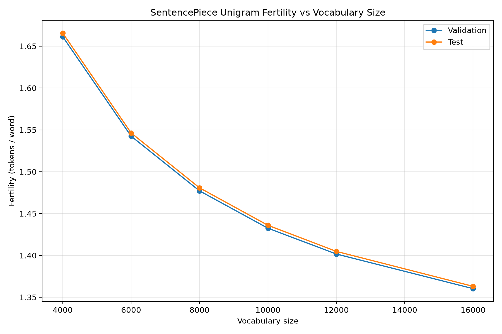


#### For the chosen 8K vocab model (keeping the model parameter constraint in mind)

Frequent Tokens Stats

| token | count | frequency (%) |
|-------|-------|---------------|
| ▁| 4942551| 0.04710908110741846
| ।| 3115379| 0.029693703108242733
| ▁के| 2758468| 0.02629186684046728
| ▁है| 2154701| 0.020537164749789262
| ","| 2139600| 0.020393232146199917
| ▁में| 1993508| 0.019000781187748506
| ▁की| 1581573| 0.01507449305718912
| ▁और| 1314217| 0.012526234983867271
| ▁से| 1246719| 0.011882889319535527
| ▁को| 1233731| 0.0117590964147333
| ▁का| 1043102| 0.00994214864374903
| ▁हैं| 845377| 0.008057566560131822
| -| 812732| 0.007746416315500724
| .| 770511| 0.0073439940616006
| ▁पर| 737252| 0.007026991580786212

Examples

Example 1

Text:

सूरतगढ़ की नर सेवा नारायण सेवा समिति की सेवाओं के लिए समिति के संरक्षक राजेंद्र सोनी ने सोमवार दोपहर को सेवा कार्यों के लिए बोलेरो कैंपर गाड़ी संस्था को भेंट की।
 नर सेवा नारायण सेवा समिति के संरक्षक ने विधिवत पूजा अर्चना के बाद इस गाड़ी को समिति को भेंट किया। अध्यक्ष विजय कटारिया, मैनेजमेंट सहायक इंजीनियर रमेश चंद्र माथुर, वरिष्ठ सहायक राधेश्याम सारस्वत, परमिशन अधिकारी राजेश भाटी, निदेशक रवि बिश्नोई ने बताया कि नर सेवा नारायण सेवा समिति द्वारा शहर में जरूरतमंद लोगों की सेवा करने, अस्पतालों में मरीजों को नियमित रूप से दूध वितरण करने, समाज सेवा के प्रकल्प चलाकर जनहित के कार्य करने, निराश्रित गोवंश के घायल होने पर अस्पताल पहुंचाने, पशुओं के लिए हरा चारा लाने, लावारिस शवों का अंतिम संस्कार करने समेत विभिन्न कार्यों के लिए वाहन की कमी खल रही थी। जिसे देखते हुए समिति के संरक्षक राजेंद्र सोनी ने यह बोलेरो कैंपर गाड़ी समिति को भेंटकर सराहनीय काम किया है।
 इस मौके पर राम लाल वर्मा, बनवारी लाल शर्मा, दयाराम और समिति से जुड़े समाजसेवी लोग मौजूद रहे। अध्यक्ष विजय कटारिया ने दानदाता और समिति संरक्षक राजेंद्र सोनी का आभार प्रकट किया।
 This website follows the DNPA Code of Ethics.

Words: 197

Pieces:

▁सूरत | गढ़ | ▁की | ▁ | नर | ▁सेवा | ▁ | नारायण | ▁सेवा | ▁समिति | ▁की | ▁सेवाओं | ▁के | ▁लिए | ▁समिति | ▁के | ▁सं | रक्षक | ▁राजेंद्र | ▁सोनी | ▁ने | ▁सोमवार | ▁दोपहर | ▁को | ▁सेवा | ▁कार्यों | ▁के | ▁लिए | ▁बोले | रो | ▁कैंप | र | ▁गाड़ी | ▁संस्था | ▁को | ▁भेंट | ▁की | । | ▁ | नर | ▁सेवा | ▁ | नारायण | ▁सेवा | ▁समिति | ▁के | ▁सं | रक्षक | ▁ने | ▁विधि | वत | ▁पूजा | ▁ | अर्चना | ▁के | ▁बाद | ▁इस | ▁गाड़ी | ▁को | ▁समिति | ▁को | ▁भेंट | ▁किया | । | ▁अध्यक्ष | ▁विजय | ▁कटा | रिया | , | ▁मैनेजमेंट | ▁सहायक | ▁इंजीनियर | ▁रमेश | ▁चंद्र | ▁मा | थु | र | , | ▁वरिष्ठ | ▁सहायक | ▁ | रा | धे | श्य | ाम | ▁ | सार | स्व | त | , | ▁परम | िशन | ▁अधिकारी | ▁राजेश | ▁भा | टी | , | ▁निदेशक | ▁रवि | ▁बि | श् | नो | ई | ▁ने | ▁बताया | ▁कि | ▁ | नर | ▁सेवा | ▁ | नारायण | ▁सेवा | ▁समिति | ▁द्वारा | ▁शहर | ▁में | ▁जरूरत | मंद | ▁लोगों | ▁की | ▁सेवा | ▁करने | , | ▁अस्पतालों | ▁में | ▁मरीजों | ▁को | ▁नियमित | ▁रूप | ▁से | ▁दूध | ▁वितरण | ▁करने | , | ▁समाज | ▁सेवा | ▁के | ▁प्र | कल्प | ▁चला | कर | ▁जन | हित | ▁के | ▁कार्य | ▁करने | , | ▁निराश | ्र | ित | ▁गो | वंश | ▁के | ▁घायल | ▁होने | ▁पर | ▁अस्पताल | ▁पहुंचाने | , | ▁पशुओं | ▁के | ▁लिए | ▁ | हरा | ▁चार | ा | ▁लाने | , | ▁ला | वा | रिस | ▁शव | ों | ▁का | ▁अंतिम | ▁संस्कार | ▁करने | ▁समेत | ▁विभिन्न | ▁कार्यों | ▁के | ▁लिए | ▁वाहन | ▁की | ▁कमी | ▁ | खल | ▁रही | ▁थी | । | ▁जिसे | ▁देखते | ▁हुए | ▁समिति | ▁के | ▁सं | रक्षक | ▁राजेंद्र | ▁सोनी | ▁ने | ▁यह | ▁बोले | रो | ▁कैंप | र | ▁गाड़ी | ▁समिति | ▁को | ▁भेंट | कर | ▁सर | ाह | नीय | ▁काम | ▁किया | ▁है | । | ▁इस | ▁मौके | ▁पर | ▁राम | ▁लाल | ▁वर्मा | , | ▁बनवा | री | ▁लाल | ▁शर्मा | , | ▁दया | राम | ▁और | ▁समिति | ▁से | ▁जुड़े | ▁समाज | से | वी | ▁लोग | ▁मौजूद | ▁रहे | । | ▁अध्यक्ष | ▁विजय | ▁कटा | रिया | ▁ने | ▁दान | दा | ता | ▁और | ▁समिति | ▁सं | रक्षक | ▁राजेंद्र | ▁सोनी | ▁का | ▁आभार | ▁प्रकट | ▁किया | । | ▁This | ▁website | ▁follows | ▁the | ▁DNPA | ▁Code | ▁of | ▁Ethics | .


# Phase-2 Report

## WANDB training stuff

### Hindi
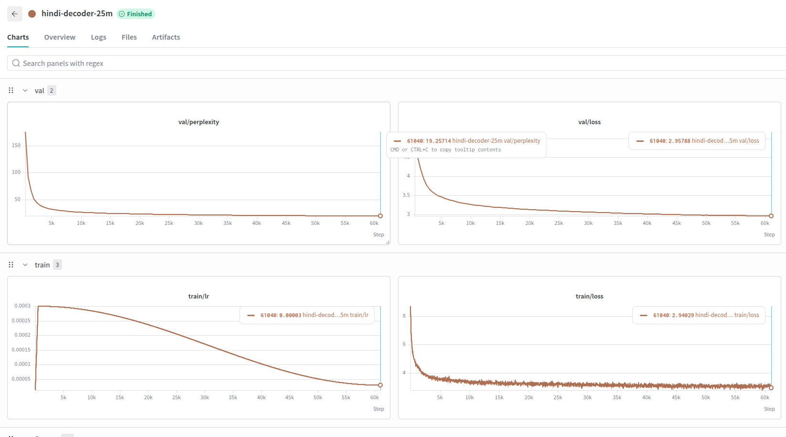

### Nepali
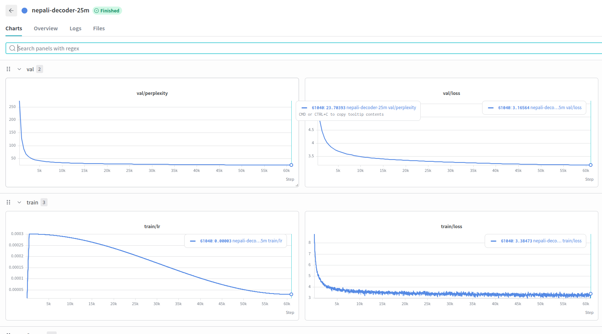

## 2.2 Configuration and Reporting

**Hyperparameters (Model H & Model L)**:
- **d_model (dimension)**: 384
- **Number of layers**: 12
- **Number of heads**: 6
- **Feed-forward width (d_ff)**: 1600
- **Context length**: 512
- **Dropout**: 0.1
- **Vocabulary Size**: 8,000 (Model H - Hindi) / 10,000 (Model L - Nepali)

**Exact Parameter Count**:
- **Model H (Hindi)**: 24,956,928 trainable parameters
- **Model L (Nepali)**: 25,724,928 trainable parameters

*Note: The input embedding layer is tied to the output projection layer.*

**Depth/Width Trade-off Justification**:
Given the constraint of approximately 25M parameters, I have chosen a deep architecture with 12 layers and a model dimension of 384 to balance that. The idea is that the increased depth would allow the model to learn more abstract relations and hierarchical features, while making sure the moderate width still provides enough representational capacity.

**Component Explanations**:
- **Rotary Position Embedding (RoPE)**: Instead of absolute positional embeddings, the models utilize RoPE, which encodes position information multiplicatively by rotating the query and key representations (Shape of angles: `[max_seq_len, dhead/2]`). Thus, capturing relative positional information effectively with no parameter overhead. Also, there is no maximum sequence length constraint as in absolute positional embeddings.
- **Multi-Head Attention (Causal Masking)**: To emperically verify the causal masking, I have given a random token sequence to the model and later changed the `t+1` token. The logits till position `t` remained unchanged with an max absolute difference `0.0`, confirming that the model cannot attend to future tokens. But, the logits at postion `t+1` changed with max absolute difference `0.66`. (In this run t = 25)
- **Layer Normalization**: Chose to apply pre-norm, as it helps to keep the gradient signal stable for deep networks. (Especially here we are using 12 layers.)
- **Output Embedding / Projection**: I have tied the input and output embedding matrices together, to save the number of parameters. To be exact, it saves around `512 * vocab_size` parameters. That is approximately `4.1M` parameters for Model H (Hindi) and `5.12M` parameters for Model L (Nepali).

## 2.3 Language Modeling and Attention Evaluation

### Intrinsic Language-Modeling Metrics

| Metric | Model H (Hindi) | Model L (Nepali) |
|---|---|---|
| Validation Cross-Entropy Loss | 2.97 | 3.17 |
| Validation Perplexity | 19.58 | 23.75 |
| Validation BPB | 0.480 | 0.422 |
| Test Cross-Entropy Loss | 3.00 | 3.15 |
| Test Perplexity | 20.13 | 23.34 |
| Test BPB | 0.485 | 0.416 |

**Discussion on the Gap**:
Model L (Nepali) has higher perplexity than Model H (Hindi) on the test split (23.34 vs 20.13). But, these can't be compared directly because both the models use tokenizers of different vocabulary sizes. Model L nevertheless obtains lower BPB (0.416 vs 0.485). Model L's (Nepali) tokenizer achieves a fertility of 1.57 and Model H's (Hindi) tokenizer achieves a fertility of 1.47. Thus, Model L is more efficient in terms of byte level compression. This could be due to the quality of the data for Nepali as compared to Hindi. I think for Hindi there is possibility of contamination with many other north Indian languages as well as the dataset also has more variable content, which might explain the higher BPB. Nepali has less data overall and less variability as well.

### Generation Quality

| Model | Decoding | BLEU-4 | chrF++ | ROUGE-L | Repeat-3 | Distinct-1 | Distinct-2 |
|---|---|---|---|---|---|---|---|
| **Model H** | Greedy | 4.66 | 15.54 | 0.0226 | 0.5907 | 0.1369 | 0.2824 |
| | T=0.5 | 5.04 | 18.07 | 0.0202 | 0.2705 | 0.1945 | 0.4901 |
| | T=1.0 | 3.30 | 18.03 | 0.0259 | 0.0218 | 0.3248 | 0.8129 |
| | T=1.5 | 2.11 | 16.39 | 0.0152 | 0.0010 | 0.4728 | 0.9731 |
| **Model L** | Greedy | 2.02 | 18.36 | 0.0029 | 0.6014 | 0.1475 | 0.2859 |
| | T=0.5 | 1.88 | 19.71 | 0.0022 | 0.3129 | 0.2167 | 0.4910 |
| | T=1.0 | 1.05 | 19.15 | 0.0015 | 0.0237 | 0.3893 | 0.8472 |
| | T=1.5 | 0.22 | 16.65 | 0.0000 | 0.0010 | 0.5366 | 0.9738 |

**Metric Informativeness**:
- **BLEU & ROUGE-L**: Poor metrics for open-ended generation. They demand exact n-gram/subsequence overlap. Thus, they are a poor choice for LLM evaluation where multiple valid continuations exist.
- **chrF/chrF++**: It is slightly more robust than BLEU and ROUGE-L because it used character n-grams. This could also be better given that Hindi and Nepali are both morphologically rich languages. But it is still a overlap metric hence bad.

**Fluency and Diversity Diagnostics (Qualitative Notes)**:

The following continuations are sampled from the held-out examples saved by the evaluation script. Each uses a 32-token prefix and generates up to 64 tokens.

- **Greedy decoding**: This gives the most likely next token at every step. It is initially grammatical and topical, but frequently enters short repetition loops, consistent with the high Repeat-3 values (Hindi: 0.5907; Nepali: 0.6014).
  - *Hindi prefix*: "डोम्बिवली भारतीय राज्य महाराष्ट्र के ठाणे ज़िले में स्थित एक नगर हैं, जो महाराष्ट्र का सबसे साक्षर शहर और भारत"
  - *Hindi generation*: "का सबसे बड़ा नगर है। . 1970 में भारत के विभाजन के बाद से भारत के विभाजन के बाद से भारत के विभाजन के बाद से भारत के विभाजन के बाद से..."
  - *Nepali prefix*: "सोल, बैशाख 23 । गुल्मी सम्पर्क समिति दक्षिण कोरियाले सातौँ रेसुंगा खुल्ला भलिवल प्रतियोगिता आयोजना गर्ने भएको छ । दक्षिण"
  - *Nepali generation*: "कोरियाको सोलमा रहेको सोलमा रहेको सोलमा रहेको सोलमा रहेको सोलमा रहेको सोलमा रहेको..."

- **Temperature $T=0.5$**: Lower-temperature sampling is a useful compromise. It reduces three-gram repetition substantially relative to greedy decoding (Hindi: 0.2705; Nepali: 0.3129) while preserving more local topicality than higher-temperature sampling. However, it remains conservative and often restates a named entity, event, or sentence frame.
  - *Hindi prefix*: "इस सप्ताह बॉक्स ऑफिस पर विद्या बालन अभिनीत और श्रीजीत मुखर्जी निर्देशित 'बेगम जान' का प्रदर्शन हुआ। अपने सुमधुर गीत"
  - *Hindi generation*: "ों और नृत्यों के लिए जाने जाने वाले विद्या बालन अभिनीत फिल्म 'बेगम जान' से अपने अभिनय का लोहा मनवा रहे हैं। विद्या बालन अभिनीत और श्रीजीत मुखर्जी निर्देशित 'बेगम जान' का प्रदर्शन किया गया। इसके बाद विद्या बालन अभिनीत और"
  - *Nepali prefix*: "काठमाडौं । उत्तर कोरिया र अमेरिकाबीच जुन १२ तारिखमा हुने भनिएको शिखर वार्तामा ढिलाइ हुने भएको छ । अमेरिकी राष्ट्रपति डोनाल्ड ट्रम्पले उत्तर कोरियाली नेता किम"
  - *Nepali generation*: "जोङ उनसँगको वार्तामा ढिलाइ हुने बताएका छन् । उत्तर कोरियाली नेता किम जोङ उनसँगको वार्तामा ढिलाइ हुने भएको हो । उत्तर कोरियाको विदेश मन्त्रालयका प्रवक्ता वाङ याङले किम जोङ उनसँगको वार्तामा ढिलाइ हुने बताएका हुन् । उत्तर कोरियाले उत्तर कोरियासँग नयाँ"

- **Temperature $T=1.0$**: This setting largely removes the severe repetition loops (Repeat-3: 0.0218 for Hindi and 0.0237 for Nepali) and has high lexical diversity (Distinct-2: 0.8129 and 0.8472). The continuations retain broad domain vocabulary, but longer passages can drift from the source context and introduce unsupported details.
  - *Hindi prefix*: "इस सप्ताह बॉक्स ऑफिस पर विद्या बालन अभिनीत और श्रीजीत मुखर्जी निर्देशित 'बेगम जान' का प्रदर्शन हुआ। अपने सुमधुर गीत"
  - *Hindi generation*: "से अभिनीत यह फिल्म बॉक्स ऑफिस पर किसी एक स्थान पर रिलीज हुई है, लेकिन अनिल कपूर की 'मिका\" की बेहतरीन अभिनेत्री लक्ष्मीबाई मलयालम और अन्य कई फिल्मों का प्रदर्शन अकादमी में अच्छी प्रदर्शन रहा है। लक्ष्मीबाई मलयालम, तमिल फिल्म उद्योग में उत्कृष्ट"
  - *Nepali prefix*: "काठमाडौं । उत्तर कोरिया र अमेरिकाबीच जुन १२ तारिखमा हुने भनिएको शिखर वार्तामा ढिलाइ हुने भएको छ । अमेरिकी राष्ट्रपति डोनाल्ड ट्रम्पले उत्तर कोरियाली नेता किम"
  - *Nepali generation*: "जोङ उनले अमेरिकासँग लड्न तयारी गरेका छन् । तर उनले अमेरिकासँग संवादका लागि अमेरिका र इरान दुवैले चासो राखेका छैनन् । उत्तर कोरियाली नेता किम जोङले दुई देशका समकक्षीलाई एकै ठाउँमा भेला हुने मौका दिएका छैनन् । अमेरिका र इरानको संयुक्त प्रयासमा अमेरिकासँग वार्ता गर्न पूर्वसम्भावित"

- **Temperature $T=1.5$**: This produces the highest diversity (Distinct-2: 0.9731 for Hindi and 0.9738 for Nepali) and near-zero three-gram repetition, but the low BLEU/ROUGE scores and qualitative inspection indicate substantially reduced local coherence. It is unsuitable when factual or sustained continuation quality matters.
  - *Hindi prefix*: "इस सप्ताह बॉक्स ऑफिस पर विद्या बालन अभिनीत और श्रीजीत मुखर्जी निर्देशित 'बेगम जान' का प्रदर्शन हुआ। अपने सुमधुर गीत"
  - *Hindi generation*: "की १० रसलिकायों को दर्शकों के सिनेमाघरों पर तेज अवतार साबित रही अल्का बिकिनीमणिकंदवाली संस्कृत स्टाइलूलीछात्राओं कीजगह जा पहुंची थीं और उनकी देखरेख में रविवार पोस्टर धूम गुप्ता करती शेरधार न बनाए। डैनी अग्रवालावरण पुरस्कार पर कुलदीप ट्रेन्वे सदस्य साकी भुएम गोलीनाथु"
  - *Nepali prefix*: "काठमाडौं । उत्तर कोरिया र अमेरिकाबीच जुन १२ तारिखमा हुने भनिएको शिखर वार्तामा ढिलाइ हुने भएको छ । अमेरिकी राष्ट्रपति डोनाल्ड ट्रम्पले उत्तर कोरियाली नेता किम"
  - *Nepali generation*: "जोङ उनको परमाणु प्रयास पुनकारायकालागि पूरा हुन सार्न लागेका हुन् । राष्ट्रपति हुने उक्त सिख बोल्सटा क्षमताको राष्ट्रपति दाबी गर्दै स्वदेशपरकै सहयोगको किन सकारात्मक बुझाएको भन्ने तर्क उनलेचन्द्र पदक रेखा खुम्चाएका हुन् किनभने उत्तर कोरियाली दुवै साथमा राखिहाबो पानी बोकेर बाइबल अध्ययनरत विद्यार्थीहरू त्यसदेशबाट उनि पनिस्कृत"

### Attention Analysis

**Attention Heatmaps & Statistics**
*(The generated heatmaps are available in the respective `attention_analysis` directories)*

* Hindi Heatmaps:
  - 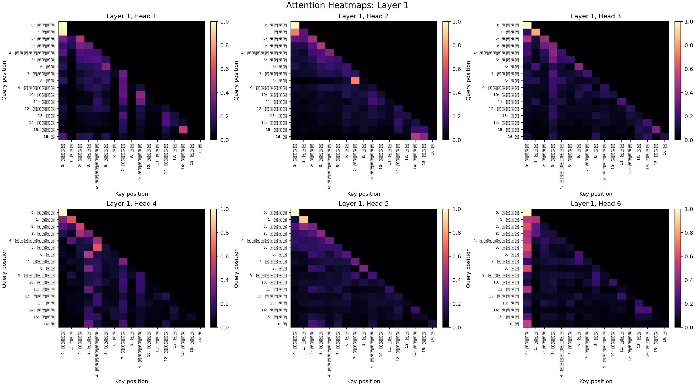
  - 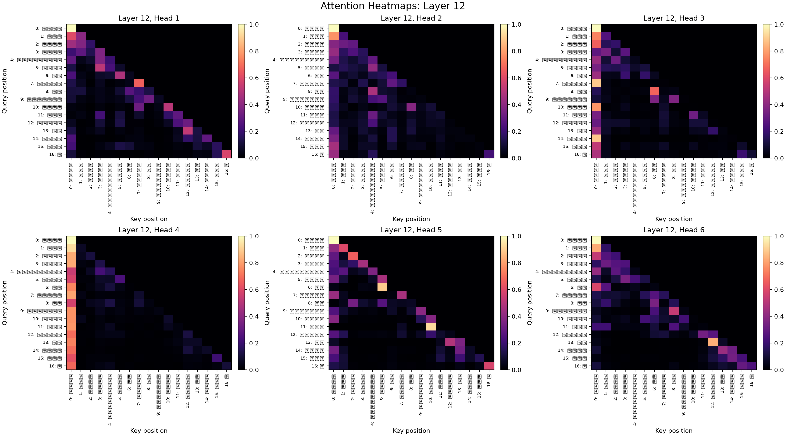
* Nepali Heatmaps:
  - 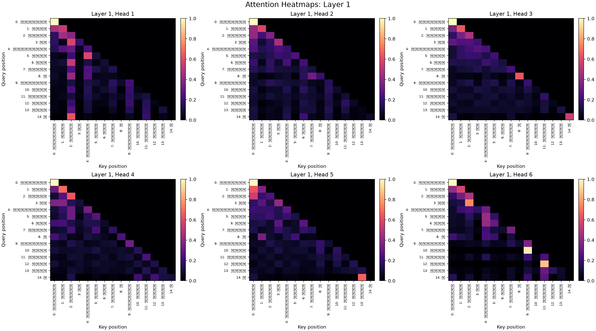
  - 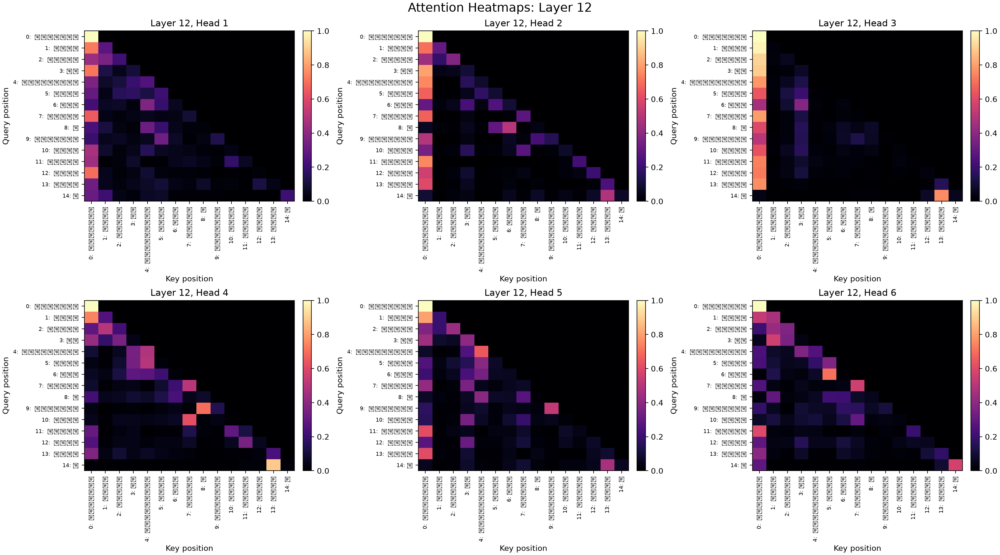
* Entropy and Distance:
  ### Hindi
  - 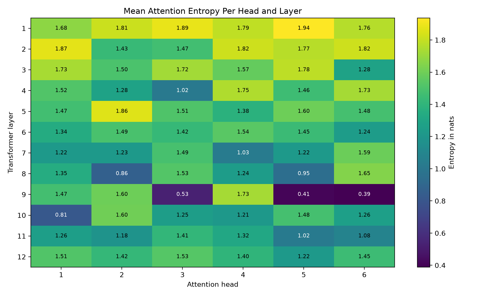
  - 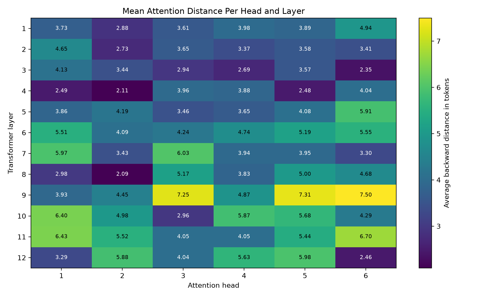
  ### Nepali
  - 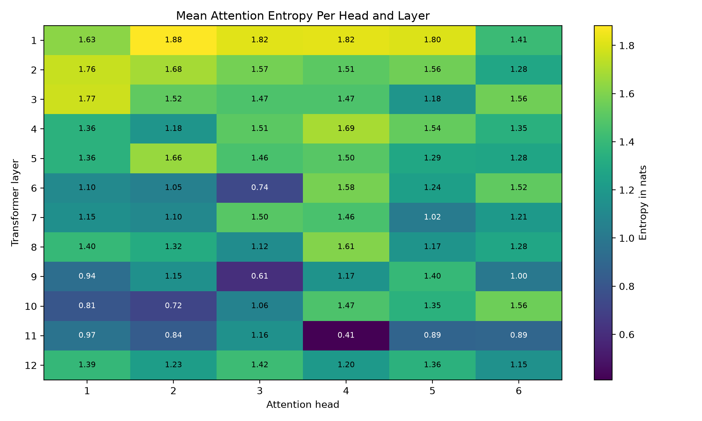
  - 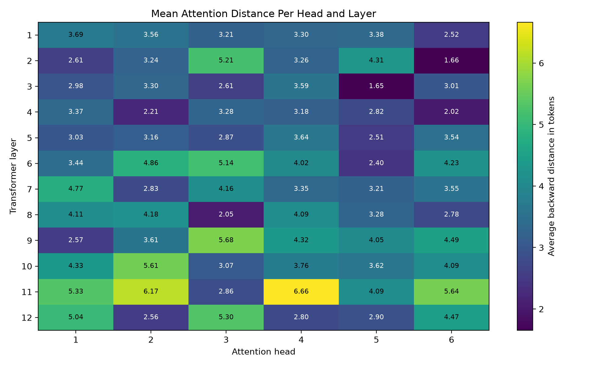

**Discussion**:
- **Local vs. Long-range Heads**: By analyzing attention entropy and mean distance, we observe that early layers (e.g., Layer 1) generally have high entropy (~1.6 - 1.9) and moderate attention distances, indicating diffuse, broad attention as the model builds initial token representations.
- **Content-based Heads**: In middle-to-late layers (e.g., Layer 9), highly specialized heads emerge. For example, in Model H's Layer 9, Heads 5 and 6 have very low entropy (0.40 and 0.38) but very high mean attention distances (7.3 - 7.5 tokens). These are content-based heads that confidently attend to specific distant tokens (like tracking entities or structural dependencies).
- **Positional Heads**: Some heads remain strictly local. In Model L's Layer 3, Head 5 has a mean distance of just 1.65, functioning primarily to look at the immediate preceding token.
- **Model H vs. Model L Differences**: Both models exhibit similar layer-wise progression (diffuse -> specialized -> mixed output formulation). Model H tends to develop slightly more distinct low-entropy, long-range heads in Layer 9, while Model L develops them slightly deeper (Layer 11).

# Phase-3 Report

#### 1. How did data scale and quality differ between Model H and Model L?
Model H (Hindi) and Model L (Nepali) had scale and quality wise almost similar datasets, they share the same script so even pre-processing was similar. Although hindi had more data overall by large margin for the scale of our project even Nepali had sufficient data.

#### 2. How do language-modeling and reasoning results compare across the two resource tiers?
Model H (Hindi) and Model L (Nepali) perform similarly in language modeling, but Model H performs better in reasoning finetuning. This is likely due to more diversity in Hindi dataset compared to Nepali dataset which was predominantly only newspaper articles.

#### 3. What tokenizer / corpus factors most affected the lower-resource model?
For Nepali I had to go with a larger vocabulary size tokenizer to achieve a smaller fertility comparable to Hindi, also the corpus being small meant I could not be very generous with the pre-processing and cleaning steps.

#### 4. What evidence explains the observed differences?
The evidence of low diversity for Nepali dataset may be seen in the lower BPB (0.422) compared to Hindi (0.480) and even the Repeat-3 values of Nepali are higher than Hindi.

## After Fine-tuning metrics

#### 1. Intrinsic Language-Modeling Metrics (Pre-trained vs. Fine-tuned)

| Metric | Model H (Hindi) Pre-trained | Model H (Hindi) Fine-tuned | Model L (Nepali) Pre-trained | Model L (Nepali) Fine-tuned |
|---|---|---|---|---|
| **Validation Cross-Entropy Loss** | 2.97 | 3.32 | 3.17 | 3.46 |
| **Validation Perplexity** | 19.58 | 27.78 | 23.75 | 31.87 |
| **Validation BPB** | 0.480 | 0.537 | 0.422 | 0.461 |
| **Test Cross-Entropy Loss** | 3.00 | 3.35 | 3.15 | 3.45 |
| **Test Perplexity** | 20.14 | 28.43 | 23.34 | 31.44 |
| **Test BPB** | 0.485 | 0.541 | 0.416 | 0.456 |

#### 2. Downstream Reasoning and Generation Evaluation (Test Set, N = 600)

Using generation-based evaluation on the 600 held-out reasoning test instances across relational and comparative reasoning tasks:

| Metric | Model H (Hindi) Pre-trained | Model H (Hindi) Fine-tuned | Model L (Nepali) Pre-trained | Model L (Nepali) Fine-tuned |
|---|---|---|---|---|
| **Logical Accuracy** | 22.17% | **85.83%** | 6.00% | **77.17%** |
| **Entity Accuracy** | 43.17% | **86.50%** | 22.17% | **79.00%** |
| **Relation Accuracy** | 59.17% | **100.00%** | 35.33% | **99.83%** |
| **Ordering Accuracy** | 0.00% | **48.78%** | 0.00% | **50.00%** |
| **Prompt Echo Rate** | 3.33% | 10.33% | 0.33% | 10.17% |
| **Empty Output Rate** | 0.17% | 0.00% | 0.00% | 0.00% |

#### 3. Task Breakdown by Question Type

##### Model H (Hindi) Breakdown
| Question Type | Count | Pre-trained Logical Acc | Fine-tuned Logical Acc | Pre-trained Entity Acc | Fine-tuned Entity Acc | Pre-trained Relation Acc | Fine-tuned Relation Acc |
|---|---|---|---|---|---|---|---|
| `compare_two` | 192 | 33.85% | **100.00%** | 68.75% | **100.00%** | 48.44% | **100.00%** |
| `largest` | 147 | 38.10% | **95.92%** | 42.86% | **95.92%** | 82.31% | **100.00%** |
| `smallest` | 110 | 4.55% | **85.45%** | 37.27% | **85.45%** | 6.36% | **100.00%** |
| `ordering` | 123 | 0.00% | **48.78%** | 1.63% | **52.03%** | 100.00% | **100.00%** |
| `relation` | 28 | 25.00% | **100.00%** | 75.00% | **100.00%** | 39.29% | **100.00%** |

##### Model L (Nepali) Breakdown
| Question Type | Count | Pre-trained Logical Acc | Fine-tuned Logical Acc | Pre-trained Entity Acc | Fine-tuned Entity Acc | Pre-trained Relation Acc | Fine-tuned Relation Acc |
|---|---|---|---|---|---|---|---|
| `compare_two` | 303 | 3.96% | **98.02%** | 21.45% | **98.35%** | 17.49% | **99.67%** |
| `largest` | 96 | 19.79% | **64.58%** | 28.12% | **64.58%** | 63.54% | **100.00%** |
| `smallest` | 87 | 1.15% | **35.63%** | 32.18% | **35.63%** | 10.34% | **100.00%** |
| `ordering` | 82 | 0.00% | **50.00%** | 1.22% | **62.20%** | 100.00% | **100.00%** |
| `relation` | 32 | 12.50% | **100.00%** | 37.50% | **100.00%** | 21.88% | **100.00%** |

#### 4. Observations & Findings
We can see that fine-tuning definitely improved the reasoning performance of the models. Also in a different way it has effected the models to now generate smaller outputs compared to before where they were yapping lengthy responses.

## Attention Analysis (post-finetune)

**Attention Heatmaps & Statistics**
*(The generated heatmaps are available in the respective `attention_analysis_reasoning` directories)*

* Hindi Heatmaps:
  - 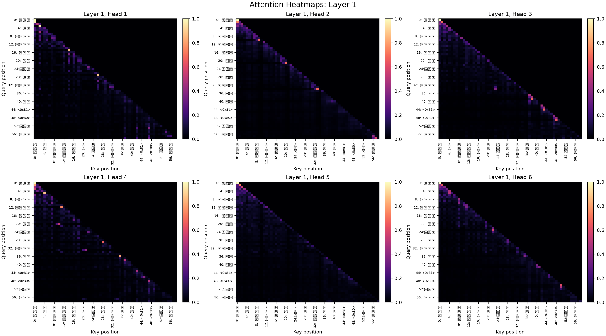
  - 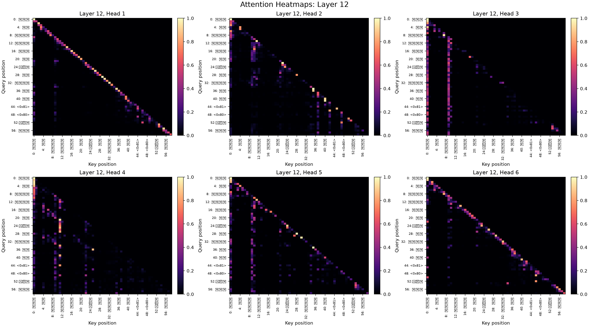
* Nepali Heatmaps:
  - 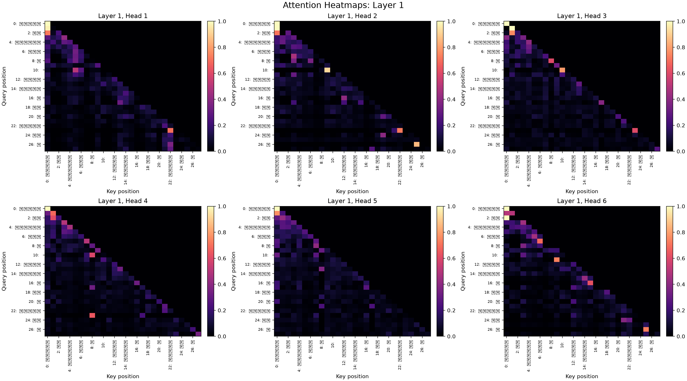
  - 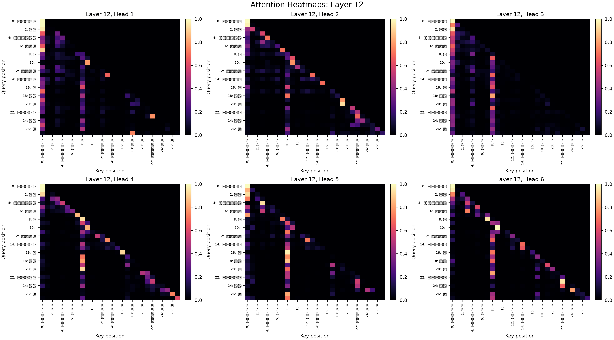
* Entropy and Distance:
  ### Hindi
  - 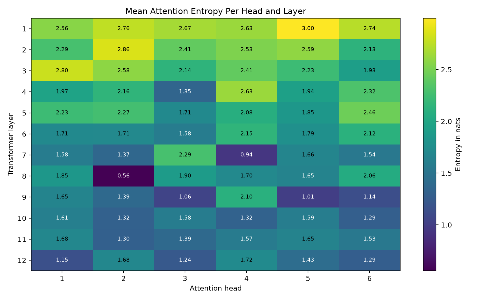
  - 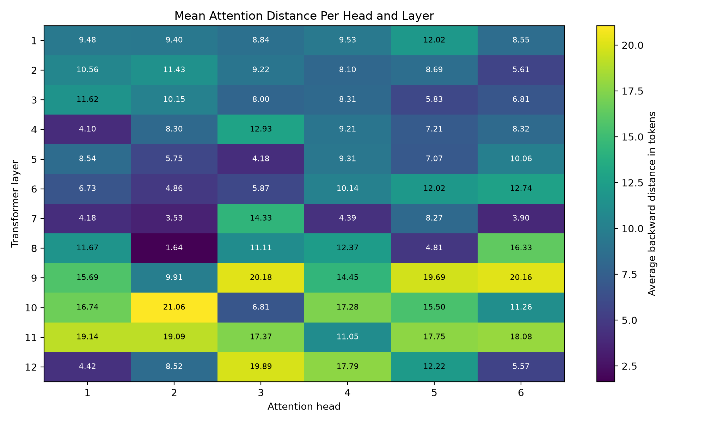
  ### Nepali
  - 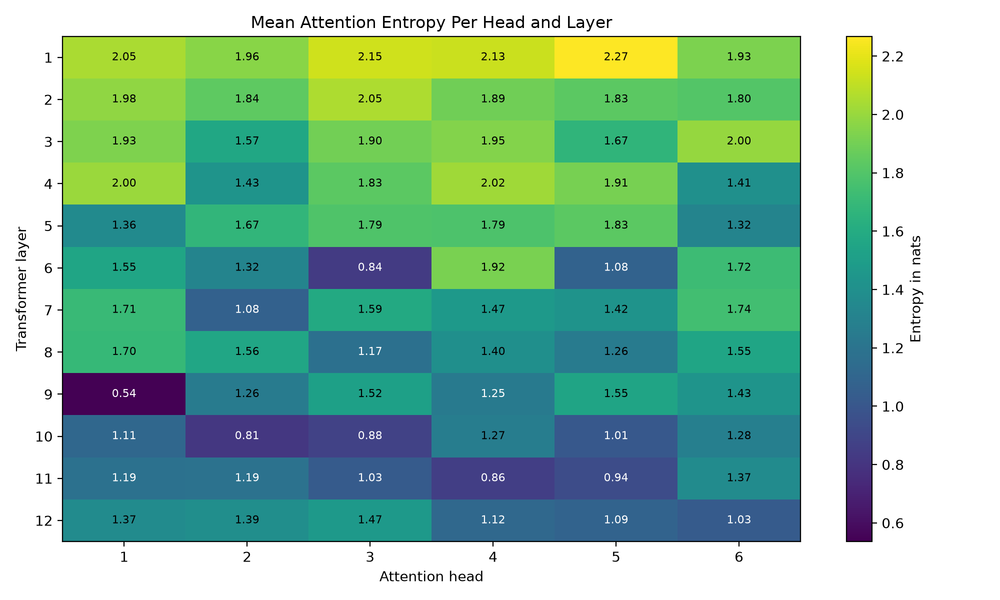
  - 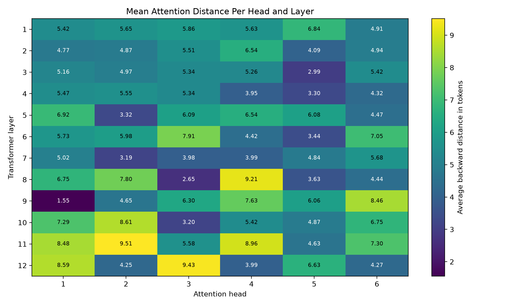

  **Comments**
  - We can see that the attention heatmaps have become more activated now on the comparison tasks, as opposed to before when some heads seemed to be idle.
  - We can see that some heads are particulary focusing on some tokens (likely the entity tokens in comparison). See head 3 layer 12 of Hindi or layer 12 heads of Nepali.
  - Some heads also seem to have become more long range now like head 3 in layer 12 of Hindi.
  - Overall, the attention patterns indicate that the model has learned to better focus on relevant tokens for reasoning tasks post-finetuning.

# Bonus Report

## Ablation: No Positional Embedding vs. RoPE (Hindi)

This section compares the standard Hindi model (**Model H**, using Rotary Position Embedding / RoPE) against the bonus Hindi model trained **without any positional embedding** (NoPE). Both models share the same architecture (12 layers, d_model=384, 6 heads, 25M parameters) and were trained on the same Hindi corpus. The only difference is the positional encoding scheme.

### Intrinsic Language-Modeling Metrics

| Metric | Model H (Hindi, RoPE) | Bonus (Hindi, No Positional Embedding) |
|---|---|---|
| **Validation Cross-Entropy Loss** | 2.97 | 5.09 |
| **Validation Perplexity** | 19.58 | 162.06 |
| **Validation BPB** | 0.480 | 0.822 |
| **Test Cross-Entropy Loss** | 3.00 | 5.11 |
| **Test Perplexity** | 20.14 | 165.04 |
| **Test BPB** | 0.485 | 0.825 |

> The model without positional embedding achieves dramatically higher perplexity (~165 vs ~20), confirming that positional information is critical for the causal language modeling task at this model scale. Without knowing token order, the model cannot learn coherent sequential structure.

### Generation Quality Metrics

Using 100 held-out examples with 32-token prefix, generating up to 64 tokens:

| Decoding | Model | BLEU-4 | chrF++ | ROUGE-L | Repeat-3 | Distinct-1 | Distinct-2 |
|---|---|---|---|---|---|---|---|
| **Greedy** | Model H (RoPE) | 2.58 | 21.70 | 0.1454 | 0.4818 | 0.2058 | 0.4088 |
| | Bonus (No Pos. Emb.) | 0.30 | 5.71 | 0.0338 | 0.2442 | 0.1977 | 0.3907 |
| **T=0.5** | Model H (RoPE) | 2.77 | 25.01 | 0.1481 | 0.1569 | 0.2974 | 0.6774 |
| | Bonus (No Pos. Emb.) | 0.19 | 8.90 | 0.0547 | 0.1674 | 0.2982 | 0.6134 |
| **T=1.0** | Model H (RoPE) | 1.24 | 25.33 | 0.1207 | 0.0044 | 0.4495 | 0.9072 |
| | Bonus (No Pos. Emb.) | 0.15 | 19.34 | 0.0726 | 0.0010 | 0.5832 | 0.9716 |
| **T=1.5** | Model H (RoPE) | 0.85 | 22.72 | 0.0780 | 0.0002 | 0.6383 | 0.9864 |
| | Bonus (No Pos. Emb.) | 0.07 | 20.38 | 0.0471 | 0.0000 | 0.6936 | 0.9980 |

### Attention heatmaps
- 
- 

**Observations**
- BLEU, ROUGE, chrF++ all are worse significantly for the no-positional-embedding model, indicating lower generation quality.
- But you can see that in Repeat and Distinct it does better. Showing model struggles in generating a meaningful sequence.
- Even perplexity wise no-positional embedding model does very badly.
- You can see that even the attention heatmaps for the heads have changed and are more diffused now for the no-positional-embedding model in comparison.
- Thus, the positional embeddings are absolutely essential for Transformer based models.

